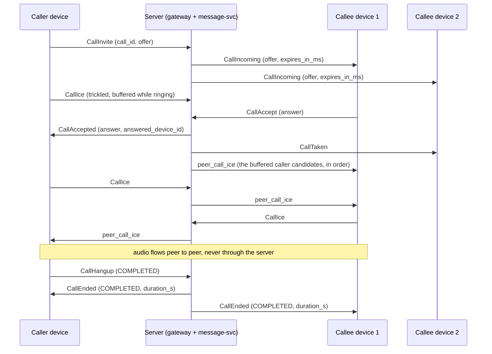

# Voice calls

1:1 WebRTC audio calls between accepted contacts (and between an owned agent and its
owner), signalled over the existing `push.v1` WebSocket. The server carries signalling
only: SDP offers and answers and ICE candidates travel through it, the audio goes peer to
peer (Opus, DTLS-SRTP end to end) and the server never sees it. Design:
[spec 2026-11-03](superpowers/specs/2026-11-03-voice-calls-design.md). Where this guide
and the spec differ, this guide describes what the code does.

- [1. Status](#1-status)
- [2. Enabling calls](#2-enabling-calls)
- [3. Capability advertisement](#3-capability-advertisement)
- [4. Wire frames](#4-wire-frames)
- [5. Error codes](#5-error-codes)
- [6. Call flow](#6-call-flow)
- [7. Client rules](#7-client-rules)
- [8. Limits](#8-limits)
- [9. Privacy](#9-privacy)
- [10. Configuration](#10-configuration)
- [11. Metrics](#11-metrics)
- [12. Call history](#12-call-history)
- [13. TURN](#13-turn)

## 1. Status

| Part | Status |
|---|---|
| Signalling (the frames below, the call engine in message-svc, the gateway relay) | available in this release, **off by default** |
| TURN credentials API (`GET /v1/calls/ice-servers`), the chart's coturn and `calls.turn` ([§13](#13-turn)) | available in this release, with calls |
| Call history (`GET /v1/calls`, `DELETE /v1/calls/{call_id}`, `CallHistoryChanged`, retention) | available in this release ([§12](#12-call-history)) |
| push-sdk calls API, bindings and a complete browser recipe | coming |
| Agents in calls (push-agent-bridge voice) | coming |

Clients get their ICE servers (STUN and TURN, with short-lived credentials) from
`GET /v1/calls/ice-servers` ([§13.1](#131-the-api)). Video, group calls,
ringing through push notifications and recording are not available; the wire leaves room
for them (spec §4.8).

## 2. Enabling calls

Calls are off until the operator sets `calls.enabled: true` in the chart, which switches
both the gateway and message-svc (`PUSH_CALLS_ENABLED=1` on each). Enable it only once
**every** gateway and message-svc replica runs a version with calls: during a rollout a
`Call` RPC that lands on an older message-svc answers `UNIMPLEMENTED`, which clients see
as a retryable `CallError UNAVAILABLE`, and devices on older gateways are never reachable.
See [§10](#10-configuration) for the other values.

## 3. Capability advertisement

- A client lists `CAPABILITY_CALLS` in `Identify.capabilities` only if it can take calls
  (it has call UI or a media helper). Only such connections ring.
- `Ready.capabilities` lists what the server offers on this connection: `CAPABILITY_CALLS`
  when the gateway has calls enabled **and** message-svc offers them. Servers from before
  calls never list anything. Hide call UI when `Ready` does not list it.
- A connection is **calls-active** only when both `Identify` and `Ready` list
  `CAPABILITY_CALLS`. Only calls-active connections receive call frames, ring, and may
  send call frames; a call frame on any other connection is answered
  `CallError NOT_AVAILABLE`.
- Right after `Ready`, every calls-active connection receives one `CallSync`.
- A callee with no calls-active device online cannot ring: the invite is answered at once
  with `CallEnded UNREACHABLE`.
- Old clients never receive call frames: they do not advertise the capability.

## 4. Wire frames

All frames are fields of `Frame.body` in
[`frame.proto`](../crates/push-proto/proto/push/v1/frame.proto), which documents every
field. Identifiers are 16-byte UUIDs; `call_id` is a **UUIDv7** the caller chooses for
`CallInvite` (version 7 is enforced) and every later frame of the call names it. Times
(`expires_at`, `answered_at`) are microseconds since the Unix epoch on the server's clock;
use the relative `expires_in_ms` for local timers.

Client to server (every refused frame is answered by a `CallError` with its `call_id`,
never by `Error`):

| Frame | # | Sent by | Effect |
|---|---|---|---|
| `call_invite` (`CallInvite`) | 11 | the caller's device | calls a contact with an audio-only offer; rings their devices, or is answered `CallEnded BUSY`/`UNREACHABLE` |
| `call_accept` (`CallAccept`) | 12 | a ringing callee device | answers with the SDP answer; the first accept wins |
| `call_decline` (`CallDecline`) | 13 | a ringing callee device | refuses the call, reason `DECLINED` (default) or `BUSY` |
| `call_cancel` (`CallCancel`) | 14 | the caller's device | withdraws a ringing call |
| `call_ice` (`CallIce`) | 15 | a party device | one trickled candidate, or `end_of_candidates` |
| `call_hangup` (`CallHangup`) | 16 | a party device | ends the call, reason `COMPLETED` (default) or `FAILED`; while ringing it cancels (caller) or declines (callee) |
| `call_renegotiate` (`CallRenegotiate`) | 17 | a party device, active calls only | a new offer or answer (ICE restart, later media changes) |

Server to client (only calls-active connections receive them):

| Frame | # | Who receives it |
|---|---|---|
| `call_incoming` (`CallIncoming`) | 44 | every calls-active device of the callee: caller, offer, `expires_at`, `expires_in_ms` |
| `call_accepted` (`CallAccepted`) | 45 | the caller's device: the answer and the answering device's id |
| `call_taken` (`CallTaken`) | 46 | the callee's other ringing devices: stop ringing, the call goes on elsewhere |
| `call_ended` (`CallEnded`) | 47 | every device involved: the caller's device, and the callee's ringing devices (while ringing) or answering device (once active), including the device whose frame ended the call; also the immediate answer to an invite that cannot ring |
| `call_error` (`CallError`) | 48 | the device whose frame was refused |
| `call_sync` (`CallSync`) | 49 | each calls-active connection, once after `Ready`: the user's calls as this device sees them |
| `call_history_changed` (`CallHistoryChanged`) | 52 | every calls-active device of the user, when a call of theirs ended or they hid one ([§12](#12-call-history)) |
| `peer_call_ice` (`CallIce`) | 50 | the other party's device: a candidate the peer sent, relayed as is |
| `peer_call_renegotiate` (`CallRenegotiate`) | 51 | the other party's device: a renegotiation the peer sent, relayed as is |

A `CallSync` lists `CallState` entries: `call_id`, `peer_user_id`, `direction` (`IN` or
`OUT`), `status` (`RINGING` or `ACTIVE`), `media`, the offer (incoming ringing calls
only), `expires_at`/`expires_in_ms` (ringing only), `answered_at` (active only) and
`this_device` (the call's device on this side is this device: the caller's device for an
outgoing call, the answering device for an active incoming one, or a ringing device).

## 5. Error codes

`CallError.code` is one of:

| Code | # | When | Retryable |
|---|---|---|---|
| `ERROR_CODE_ALREADY_ANSWERED` | 27 | `CallAccept` or `CallCancel` after a callee device answered | no |
| `ERROR_CODE_CALL_NOT_FOUND` | 28 | no such call for this device in this role: unknown, ended, another user's, or a frame the device may not send (for example `CallRenegotiate` while ringing, `CallIce` from a callee device before its accept). One answer for all: drop the call locally | no |
| `ERROR_CODE_IN_CALL` | 29 | the caller already has a call, ringing or active, on any of their devices | no |
| `ERROR_CODE_CALL_LIMIT` | 30 | the call's cap of `CallIce` or `CallRenegotiate` frames is reached ([§8](#8-limits)) | no |
| `ERROR_CODE_NOT_CONTACT` | 6 | not an accepted contact, a block either way, an agent rule, or no such user: indistinguishable | no |
| `ERROR_CODE_INVALID` | 2 | malformed ids, a `call_id` that is not a UUIDv7, calling oneself, a bad or oversize SDP, video, a bad candidate, a reason the frame does not allow, the same `call_id` invited by another device | no |
| `ERROR_CODE_RATE_LIMITED` | 23 | too many `CallInvite` per hour, with `retry_after_s` | yes, after `retry_after_s` |
| `ERROR_CODE_NOT_AVAILABLE` | 24 | calls are not offered on this connection (not calls-active) | no |
| `ERROR_CODE_UNAVAILABLE` | 9 | Redis or message-svc unavailable, or too many concurrent changes to the call | yes |

Busy and unreachable callees are not errors: the invite is answered `CallEnded BUSY` or
`CallEnded UNREACHABLE`.

## 6. Call flow

The normal flow, a callee with two devices:



How a call ends (`CallEnded.reason`):

| Reason | When | Sent to |
|---|---|---|
| `COMPLETED` | a party sent `CallHangup` (reason `COMPLETED` or absent) after the answer | both party devices, with `duration_s` |
| `MISSED` | nobody answered before ringing timed out (`calls.ringSeconds`), or an accept arrived after it | the caller's device and the ringing devices (a late accepter too) |
| `DECLINED` | a ringing callee device sent `CallDecline` (or `CallHangup`) | the caller's device and the ringing devices |
| `CANCELLED` | the caller sent `CallCancel` (or `CallHangup`) while ringing | the caller's device and the ringing devices |
| `BUSY` | the callee is in a call or ringing for one (immediate answer to the invite), or a ringing device declined with `BUSY` | the caller's device (and the ringing devices for a decline) |
| `FAILED` | a party hung up with `FAILED`, or a party device stayed disconnected longer than `calls.disconnectGraceSeconds` (also the caller's device while ringing) | every device involved (`duration_s` once answered) |
| `UNREACHABLE` | the callee has no calls-active device online (immediate answer to the invite) | the caller's device |

`duration_s` counts whole seconds from the answer to the end and is set only for calls
that were answered. A block does not end a call already ringing or active; it prevents the
next one.

A user has at most one call, ringing or active, across all their devices. Resending a
`CallInvite` with the same `call_id` from the same device while it rings is a harmless
retry; resending `CallAccept` from the answering device sends `CallAccepted` to the caller
again.

## 7. Client rules

- **Only the caller makes the initial offer**, in `CallInvite`. The callee answers in
  `CallAccept`.
- **Renegotiation** (`CallRenegotiate`: ICE restart, later media changes) may come from
  either side once the call is active. Resolve glare with
  [perfect negotiation](https://developer.mozilla.org/en-US/docs/Web/API/WebRTC_API/Perfect_negotiation):
  the **callee is polite**, the caller impolite.
- **Trickle ICE**: send each local candidate as `CallIce` as it is gathered, then one with
  `end_of_candidates: true` and an empty candidate. The caller may trickle while ringing
  (the server buffers up to 32 and hands them to the answering device right after its
  accept). The callee sends `CallAccept` first and its candidates after (a callee
  `CallIce` before the accept is `CALL_NOT_FOUND`).
- **Buffer peer ICE**: `peer_call_ice` may arrive before the client has applied
  `CallAccepted` (caller) or set the remote description (callee). Queue candidates per
  `call_id` and add them once the remote description is set.
- **Ringing**: ring locally for `expires_in_ms` from receipt (not until `expires_at`: the
  device clock may be skewed); stop on `CallTaken` or `CallEnded`.
- **After every reconnect**, read `CallSync`: drop every local call it does not list; a
  listed ringing incoming call can still be answered (its offer is included); for a
  listed `ACTIVE` call with `this_device`, restart ICE with a `CallRenegotiate` offer
  created with `iceRestart`. A party device that stays away longer than the disconnect
  grace ends the call `FAILED`.
- **`CallCancel` answered `ALREADY_ANSWERED`** means the call connected: send
  `CallHangup` to end it.
- **`CALL_NOT_FOUND`**: the call is gone for this device; release its media.
- On `CallEnded`, release the call's media and close the peer connection.

## 8. Limits

| Limit | Value | Refused with |
|---|---|---|
| SDP (offer, answer, renegotiation) | at most 16 KiB (16384 bytes) of UTF-8; lines `<letter>=<value>`, first line `v=0`; at least one `m=audio` and no other `m=` kind (audio only) | `INVALID` |
| ICE candidate | at most 512 bytes of printable ASCII starting with `candidate:` (or empty with `end_of_candidates`); `sdp_mid` at most 32 bytes, `username_fragment` at most 256 | `INVALID` |
| `CallIce` per side per call | 200 | `CALL_LIMIT` |
| Caller `CallIce` buffered before the answer | 32 | `CALL_LIMIT` |
| `CallRenegotiate` per side per call | 20 | `CALL_LIMIT` |
| `CallInvite` per user per hour, refused or not | `calls.attemptsPerHour` (30) | `RATE_LIMITED` with `retry_after_s` |
| Calls per user | one, ringing or active, across all devices | `IN_CALL` (caller) or `CallEnded BUSY` (callee) |

## 9. Privacy

- The server never sees media: audio goes peer to peer, encrypted end to end by
  DTLS-SRTP.
- It relays SDP and ICE candidates as opaque strings, after the contact policy, and only
  to the call's devices: the offer to the callee's ringing devices (in `CallIncoming` and
  `CallSync`), the answer to the caller's device, the callee's candidates only after the
  callee accepted, and the caller's pre-answer candidates only to the answering device
  (ringing devices never receive them). Ringing devices that did not answer never learn
  the caller's addresses from candidates.
- SDP and candidates are kept only in the call's Redis record while the call lives, and
  never appear in logs, metrics or audit lines (the audit records `call.started` and
  `call.ended` with ids, reason and duration only). The gateway never logs WebSocket
  payloads, even at `RUST_LOG=trace`.
- **Use trickle ICE** so the offer carries no candidates: then the callee's ringing
  devices, which receive the offer, learn none of the caller's addresses.
- `iceTransportPolicy: "relay"` with the servers of `GET /v1/calls/ice-servers` keeps
  both sides' IP addresses from each other (the peer sees only the relay). TURN
  credentials name the user they were minted for and are never logged.
- Call history holds ids, times, direction, duration and outcome only (never SDP,
  candidates or addresses). Each participant has a row of their own; only they read or hide
  it ([§12](#12-call-history)). Rows are deleted after `calls.historyDays` (90 days).

## 10. Configuration

Chart values (validated by the chart and by the services at start):

| Value | Default | Range | Env |
|---|---|---|---|
| `calls.enabled` | `false` | `true` or `false` | `PUSH_CALLS_ENABLED` (`1`/`0`) on the gateway and message-svc |
| `calls.ringSeconds` | `45` | integer 10–120 | `PUSH_CALLS_RING_SECONDS` (message-svc) |
| `calls.disconnectGraceSeconds` | `30` | integer 5–120 | `PUSH_CALLS_DISCONNECT_GRACE_SECONDS` (message-svc) |
| `calls.attemptsPerHour` | `30` | integer 1–1000 | `PUSH_CALLS_ATTEMPTS_PER_HOUR` (gateway) |
| `calls.historyDays` | `90` | integer 1–3650 | `PUSH_CALLS_HISTORY_DAYS` (message-svc): call history retention, applied whether calls are enabled or not |
| `calls.turn.*` | `mode: internal` | see [§13.3](#133-chart-values) | `PUSH_TURN_*` (auth-svc), the coturn objects |

The chart refuses an invalid value naming it, for example `"calls.historyDays must be an integer from 1 to 3650"`; the services refuse it at start naming the variable.

## 11. Metrics

message-svc serves Prometheus text (format 0.0.4) at `GET /metrics` on its health
listener (`PUSH_HEALTH_ADDR`, port 8081). While calls are disabled it holds only the call
history families.
Labels are reasons, codes and frame kinds only, never call content.

| Metric | Type | Labels |
|---|---|---|
| `push_calls_started_total` | counter | — |
| `push_calls_answered_total` | counter | — |
| `push_calls_ended_total` | counter | `reason`: completed, missed, declined, cancelled, busy, failed, unreachable |
| `push_call_frames_refused_total` | counter | `code`: not_contact, call_not_found, invalid, already_answered, in_call, call_limit, unavailable |
| `push_call_setup_seconds` | histogram | — (an accept received → `CallAccepted` published) |
| `push_call_signal_seconds` | histogram | `frame`: invite, accept, decline, cancel, ice, hangup, renegotiate (time to handle and publish a call frame) |
| `push_calls_live` | gauge | — (calls ringing or active; absent while Redis does not answer) |
| `push_call_history_rows_deleted_total` | counter | — (rows deleted by the retention purge; also with calls disabled) |
| `push_call_history_write_failures_total` | counter | — (ended calls whose history rows could not be stored after 3 attempts; also with calls disabled) |

Rate-limited invites are refused by the gateway before they reach message-svc and are not
counted here.

auth-svc serves its TURN credential counters the same way, at `GET /metrics` on its
health port (8081; empty without TURN settings), labelled by `mode` (`internal`,
`generic`, `cloudflare`, `twilio`, `stun-only`) only:

| Metric | Type | Labels |
|---|---|---|
| `push_turn_credentials_issued_total` | counter | `mode` (ICE server lists handed out) |
| `push_turn_credentials_failures_total` | counter | `mode` (requests answered `turn_unavailable`) |
| `push_turn_provider_requests_total` | counter | `provider`, `outcome`: `ok`, `error` (cloudflare and twilio: calls to the provider; the rest were served from memory) |

coturn's own allocations and relayed traffic: [§13.4](#134-coturn-in-the-chart).

## 12. Call history

Calls are kept apart from conversations: nothing about a call is ever written into a
conversation (there are no "missed call" messages). Instead each participant has a call
history, served by auth-svc with the same access token as the rest of the HTTP API.

**What is recorded.** When a call ends, message-svc stores one row per participant: the
caller's (`direction: "out"`) always, and the callee's (`direction: "in"`) for every
outcome except `unreachable` (the callee never saw that call). Invites answered at once
with `CallEnded BUSY` are recorded too, for both sides; `UNREACHABLE` only for the caller.
Ringing and active calls are not in the history; they are in `CallSync`. The `outcome` is
the `CallEnded.reason` the call ended with.

### `GET /v1/calls`

```
GET /v1/calls?before=<cursor>&since=<cursor>&limit=50
Authorization: Bearer <access token>
```

All parameters are optional. The answer lists the caller's own calls that they did not
hide, **newest first** (by end time, then call id):

```json
{
  "calls": [
    {
      "call_id": "01937a4e-…",
      "peer_user_id": "01936f02-…",
      "direction": "in",
      "started_at": "2026-11-03T17:41:05.120Z",
      "answered_at": "2026-11-03T17:41:09.002Z",
      "ended_at": "2026-11-03T17:43:10.877Z",
      "duration_s": 121,
      "outcome": "completed",
      "cursor": "MTc2MjE5MTc5MDg3NzAwMDowMTkzN2E0ZS0…"
    }
  ],
  "next": "MTc2MjE5MTc5MDg3NzAwMDowMTkzN2E0ZS0…"
}
```

| Field | Meaning |
|---|---|
| `call_id` | the call's id (the `call_id` of its frames) |
| `peer_user_id` | the other participant |
| `direction` | `out`: you called; `in`: you were called |
| `started_at` | when the call was invited (RFC 3339, UTC, milliseconds; server clock) |
| `answered_at` | when it was answered; absent for calls never answered |
| `ended_at` | when it ended |
| `duration_s` | whole seconds from the answer to the end; `0` for calls never answered |
| `outcome` | `completed`, `missed`, `declined`, `cancelled`, `busy`, `failed` or `unreachable` (as `CallEnded.reason`) |
| `cursor` | this call's position, for `before` and `since` |
| `next` | present only when the page is full (`limit` calls): the last call's cursor; ask again with `before=<next>` for older calls |

- `limit`: 1 to 100, default 50.
- `before=<cursor>`: only calls strictly older than that position (paging back).
- `since=<cursor>`: only calls strictly newer than that position (what is new since you
  last looked). `before` and `since` combine.
- Cursors are opaque strings (URL-safe, no padding); pass them back unchanged. Paging with
  `next` never repeats or skips a call, even when calls end in the same millisecond.
- Errors: `400 invalid` naming `limit`, `before`, `since` or `query` (a parameter given
  twice); `401` without a valid access token; `429 rate_limited` (120 requests per minute
  per user, 600 per IP, shared with `DELETE`); `503 unavailable` (retryable) when
  message-svc does not answer.
- Never cached (`Cache-Control: no-store`).

### `DELETE /v1/calls/{call_id}`

Hides the call from **your** history only: the other participant still sees it, and the
call itself is unaffected. Answers `204` whether or not you had such a call (the answer
never tells which calls exist); a hidden call stays hidden, even if it is recorded again.
`400 invalid` (`call_id`) when the id is not a UUID. Audited as `calls.history.hidden`
(the security log of auth-svc); reads are not audited.

### Missed-call badge: `CallHistoryChanged` and `since`

Every calls-active device of a user receives the server frame `call_history_changed`
(`CallHistoryChanged`, field 52) when a call of theirs ended and its row is stored
(`latest_ended_at`: the call's end, microseconds since the Unix epoch), or when one of
their devices hid a call (`latest_ended_at` absent). It never carries the call: refresh
the history. A recipe for a badge:

1. Keep the `cursor` of the newest call the user has seen (for example when they open the
   call list).
2. On `CallHistoryChanged`, and after every reconnect (the event is not replayed),
   `GET /v1/calls?since=<that cursor>`; count the calls with `direction: "in"` and
   `outcome: "missed"` (and `busy`, if you show those).
3. When the user opens the call list, store the newest `cursor` again.

Devices that are not calls-active (older clients, apps without call UI) do not receive
the frame; they can poll with `since`.

### Retention

message-svc deletes rows of calls that ended more than `calls.historyDays` days ago
(`PUSH_CALLS_HISTORY_DAYS`, default 90, 1 to 3650), hidden or not, every hour (and at
start), in batches of 1000. The purge runs whether calls are enabled or not, so history
recorded while calls were on still expires after they are switched off. Each replica
purges; deleting is idempotent. A shorter retention takes effect within an hour of the
change.

### Storage and privacy

- The rows live in message-svc's database (`messaging.call_history`, migration
  `0008_call_history.sql`, a new table only). They hold ids, times, direction, duration
  and outcome: never SDP, candidates or IP addresses.
- `GET` reads only the rows of the user in the access token; `DELETE` sets the hidden
  time on that user's row only. There is no way to name another user.
- A failed write (the database unavailable) is retried three times, then logged with the
  call id and counted (`push_call_history_write_failures_total`); the call has ended
  regardless.

## 13. TURN

Two devices behind symmetric NATs or restrictive firewalls cannot reach each other
directly: their media must go through a relay (TURN). auth-svc hands each signed-in user
short-lived TURN credentials for the relay the deployment chose:

| `calls.turn.mode` | Relay | Credentials |
|---|---|---|
| `internal` (default) | **coturn deployed by the chart** ([§13.4](#134-coturn-in-the-chart)) | TURN REST: `username = "<expiry unix seconds>:<user id>"`, `credential = base64(HMAC-SHA1(turn-shared-secret, username))`; coturn checks them with `use-auth-secret` |
| `external`, `provider: generic` | a provider or a coturn of your own speaking the TURN REST scheme (Xirsys, a self-run coturn, …) at `external.urls` | the same scheme with the provider's shared secret |
| `external`, `provider: cloudflare` | Cloudflare Realtime TURN | auth-svc calls `POST https://rtc.live.cloudflare.com/v1/turn/keys/<keyId>/credentials/generate-ice-servers` with the key's API token (`Bearer`) and `{"ttl": ttlSeconds}`, and hands out the `iceServers` of the answer (URLs on port 53 are dropped: browsers block them) |
| `external`, `provider: twilio` | Twilio Network Traversal Service | auth-svc calls `POST https://api.twilio.com/2010-04-01/Accounts/<accountSid>/Tokens.json` with Basic auth (account SID and auth token) and `Ttl=ttlSeconds`, and hands out its `ice_servers` (lifetime: the shorter of `ttlSeconds` and Twilio's `ttl`) |
| `stun-only` | none: `relay: false`. Development only; calls between symmetric NATs fail | none |

Provider credentials are kept per user in auth-svc's memory and handed out again until a
minute (a fifth of `ttlSeconds` when that is shorter) before they expire; concurrent
requests of one user make one provider call. Each auth-svc replica keeps its own.

### 13.1 The API

`GET /v1/calls/ice-servers` with the access token (`Authorization: Bearer …`). It
answers `200`:

```json
{
  "ice_servers": [
    { "urls": ["stun:turn.example.com:3478"] },
    {
      "urls": [
        "turn:turn.example.com:3478?transport=udp",
        "turn:turn.example.com:3478?transport=tcp",
        "turns:turn.example.com:5349?transport=tcp"
      ],
      "username": "1793729000:0193f0c2-6f0e-7c4d-9a2b-1c3d4e5f6a7b",
      "credential": "VQi7KgKAXiAc6ZhbTP2coGjJMjw="
    }
  ],
  "expires_at": "2026-11-03T18:43:20Z",
  "relay": true
}
```

- `ice_servers` is the browser's `RTCConfiguration.iceServers` as is (`urls`,
  `username`, `credential`); STUN entries have no credentials. Pass it unchanged:
  `new RTCPeerConnection({ iceServers: body.ice_servers })`.
- `expires_at` (RFC 3339, UTC): the credentials stop working then; an allocation made
  before keeps working while it is refreshed. Fetch new servers for every call, or when
  fewer than 60 s are left, and hand them to a running call with
  `RTCPeerConnection.setConfiguration()` before an ICE restart.
- `relay`: whether a TURN server is among them (`false` in `stun-only` mode). Without a
  relay, calls between symmetric NATs fail: say so instead of ringing for nothing, or
  offer the call anyway.
- For IP privacy use `iceTransportPolicy: "relay"` (only with `relay: true`).

Errors use the API's format (`{"error": {"code", "message", "retryable"}}`):

| Status | `code` | When |
|---|---|---|
| 401 | `unauthorized`, `token_expired` | no or a bad access token |
| 429 | `rate_limited` (`Retry-After`) | more than 60 requests per user per hour (600 per IP) |
| 503 | `turn_unavailable` (`Retry-After: 30`, retryable) | no TURN configured (`calls.enabled` false), or the provider failed or answered with nothing usable. The API never returns servers that could not work |

Client SDKs: the push-sdk `Calls::ice_servers()` arrives with the SDK calls API.

### 13.2 Security

- **Credentials** are scoped to the user (the username names them; provider credentials
  are minted per user), short-lived (`ttlSeconds`, 10 minutes by default), minted only for
  a valid access token, served with `Cache-Control: no-store` over HTTPS, and never
  logged: auth-svc's logs, audit lines and metrics carry no credential, username, secret
  or provider token (`Debug` output is redacted; tests check the logs). A leaked
  credential works until it expires, for at most `quotas.user` allocations.
- **Provider secrets** (Cloudflare API token, Twilio auth token, a generic shared secret)
  come only from the Secret or a mounted file, never from chart values: the `…Secret`
  values name a Secret key. auth-svc calls providers over HTTPS with a 5 s timeout and
  logs only the HTTP status of a failure.
- **A public relay is an open UDP port range.** Anyone can reach coturn's ports; only
  holders of valid credentials can allocate. What keeps the relay from becoming an SSRF
  or lateral-movement tool is that coturn **never relays to internal addresses**
  (`denied-peer-ip`): RFC 1918, CGNAT (100.64/10, which includes Alibaba's metadata),
  loopback, link-local (169.254/16, the AWS/Azure/GCP metadata 169.254.169.254), Oracle's
  192.0.0.192, Azure's host address 168.63.129.16, multicast and reserved ranges,
  documentation ranges, and the IPv6 equivalents (ULA fc00::/7 with AWS's
  fd00:ec2::254, link-local, site-local, multicast, and the IPv4-embedding IPv4-mapped,
  NAT64, Teredo and 6to4 ranges), plus your cluster's pod and service CIDRs
  (`deniedPeerCidrs`, required). The list is
  [`files/coturn/denied-peers.txt`](../deploy/helm/push-messenger/files/coturn/denied-peers.txt);
  an integration test proves the real coturn refuses these peers (403). The coturn pod's
  NetworkPolicy repeats the list as egress exceptions, as a second layer where the CNI
  enforces policies.
- **Bandwidth and allocation abuse** is bounded by `user-quota` (12 concurrent
  allocations per user, counted by the user id across credentials), `total-quota` (1200)
  and `max-bps` (512000 bytes per second per session; Opus audio needs about 10 kB/s).
  Raise them only with a reason.
- Not configured on purpose: TCP relay (RFC 6062) stays on (`no-tcp-relay` is not set)
  for clients that can only use TCP; RFC 5780 NAT discovery is off (`no-rfc5780`); DTLS
  listeners and the CLI are off (coturn's defaults).
- **Trade-off of a local relay**: because private ranges are denied, coturn cannot relay
  to peers on private addresses, so on a LAN-only or local cluster setup relayed calls
  fail (use direct candidates or `stun-only` there, [§13.6](#136-local-clusters)).

### 13.3 Chart values

Validated when `calls.enabled` is true (the mode always); a failing render names the
field. Values under `calls.turn`:

| Value | Default | Rule (failure message names the field) |
|---|---|---|
| `mode` | `internal` | `internal`, `external` or `stun-only`: "calls.turn.mode must be internal, external or stun-only" |
| `ttlSeconds` | `600` | integer 60–86400 |
| `stunUrls` | `[]` | `stun:`/`stuns:` URLs, listed first; required with `stun-only` ("calls.turn.stunUrls must not be empty with calls.turn.mode stun-only") |
| `internal.enabled` | `true` | `false`: no coturn here; auth-svc still mints `internal` credentials for a coturn run elsewhere with the Secret's `turn-shared-secret` at `publicHost` and `ports` |
| `internal.publicHost` | `""` | required: the DNS name or IP clients reach coturn at, over UDP too ("calls.turn.internal.publicHost must be the DNS name or IP address clients reach coturn at") |
| `internal.realm` | `""` | empty: `publicHost` |
| `internal.ports` | `{udp: 3478, tcp: 3478, tls: 5349}` | the public Service ports, 1–65535 (coturn listens on 3478 and 5349; e.g. `tls: 443` for firewalls that only pass 443) |
| `internal.relayPortRange` | `"49160-49200"` | `"<min>-<max>"`, 1024 ≤ min ≤ max ≤ 65535, at most 500 ports; each port is a UDP and a TCP Service port, so keep it small (one relay port per relayed call leg) |
| `internal.tlsSecret` | `""` | a `kubernetes.io/tls` Secret: adds `turns:` on `ports.tls` |
| `internal.service` | `{type: LoadBalancer, annotations: {}, loadBalancerIP: ""}` | `LoadBalancer` or `ClusterIP` (not `NodePort`: node ports cannot carry the relay ports at their numbers); string annotations; an IP; the public ports must differ from each other and lie outside the relay range |
| `internal.resources` | `{}` | container resources |
| `internal.externalIp` | `""` | the public IP coturn advertises as its relay address; empty: `service.loadBalancerIP`, else `publicHost` when it is an IP. One of them is required ("calls.turn.internal.externalIp must be set …") |
| `internal.deniedPeerCidrs` | `[]` | required: the cluster's pod and service CIDRs (IPv4 and IPv6 network addresses, at least /8 and /16) ("calls.turn.internal.deniedPeerCidrs must list the cluster's pod and service CIDRs") |
| `internal.quotas` | `{user: 12, total: 1200, maxBps: 512000}` | integers 1–1000, 1–100000, 8000–1000000000 |
| `internal.image` | `coturn/coturn:4.18.0-alpine@sha256:c29135c0…` | `<repository>:<tag>@sha256:<digest>` |
| `internal.metricsPeers` | `[]` | peers allowed to scrape coturn's port 9641 (both label maps, like `networkPolicy.adminPeers`) |
| `external.provider` | `generic` | `generic`, `cloudflare` or `twilio` |
| `external.urls` | `[]` | `generic`: required `turn:`/`turns:` URLs |
| `external.sharedSecret` | `""` | `generic`: the **name of the Secret key** with the shared secret (default `turn-shared-secret`) |
| `external.cloudflare` | `{keyId: "", apiTokenSecret: ""}` | the TURN key id (required) and the Secret key with its API token (default `turn-cloudflare-token`) |
| `external.twilio` | `{accountSid: "", authTokenSecret: ""}` | `AC` + 32 hex digits (required) and the Secret key with the auth token (default `turn-twilio-token`) |

`external` needs a consumer-managed Secret (`secrets.existingSecret`) or `secrets.volume`
(files `secrets.files.turn-*`); with `secrets.volume` the `…Secret` key names stay empty.
In `internal` mode a chart-managed Secret gets a generated `turn-shared-secret`; a
consumer-managed one must hold it ([deployment-configuration.md](deployment-configuration.md#credentials)).

auth-svc variables (rendered by the chart; for running it yourself):

| Variable | Meaning |
|---|---|
| `PUSH_TURN_MODE` | `internal`, `external`, `stun-only`; unset: `turn_unavailable` |
| `PUSH_TURN_TTL_SECONDS` | 60–86400 (600) |
| `PUSH_TURN_STUN_URLS`, `PUSH_TURN_URLS` | comma-separated STUN and TURN URLs (`internal`, `generic`) |
| `PUSH_TURN_PROVIDER` | `generic`, `cloudflare`, `twilio` |
| `PUSH_TURN_SHARED_SECRET` | `internal`, `generic`: at least 16 visible ASCII characters |
| `PUSH_TURN_CLOUDFLARE_KEY_ID`, `PUSH_TURN_CLOUDFLARE_TOKEN` | `cloudflare` |
| `PUSH_TURN_TWILIO_ACCOUNT_SID`, `PUSH_TURN_TWILIO_TOKEN` | `twilio` |

The secrets also accept `<name>_FILE`. Invalid values stop auth-svc at start, naming the
variable.

### 13.4 coturn in the chart

With `calls.enabled`, `mode: internal` and `internal.enabled`, the chart renders:

- **Deployment `<release>-coturn`**: one replica (an allocation and its relay port live
  in one process), `Recreate` updates, the pinned image as user 65534 with a read-only
  root, no capabilities and no service account token. An init container writes the
  configuration with `static-auth-secret` into memory (`/run/coturn`), so the secret is
  never in a ConfigMap or on a command line. TCP readiness and liveness probes on 3478.
- **ConfigMap**: [`files/coturn/turnserver.conf`](../deploy/helm/push-messenger/files/coturn/turnserver.conf)
  plus `realm`, `external-ip`, `min-port`/`max-port`, the quotas, TLS (`cert`/`pkey` or
  `no-tls`) and one `denied-peer-ip` range per denied CIDR.
- **Service `<release>-coturn`** (`LoadBalancer` by default, `externalTrafficPolicy:
  Local` so coturn sees client addresses): `ports.udp`/UDP and `ports.tcp`/TCP to 3478,
  `ports.tls`/TCP to 5349 with `tlsSecret`, and every relay port over UDP and TCP. It is
  not an Ingress route: TURN is not HTTP.
- **Service `<release>-coturn-metrics`** (ClusterIP, 9641): coturn's Prometheus
  endpoint (`turn_total_allocations`, `turn_total_traffic_*`, `turn_auth_credential_failures`;
  without usernames as labels, coturn's default). The chart adds no scrape configuration.
- **NetworkPolicy `<release>-coturn`** (with `networkPolicy.enabled`): ingress from
  anywhere on 3478 (UDP/TCP), 5349 (TLS) and the relay range; 9641 only from
  `metricsPeers`; egress to `0.0.0.0/0` and `::/0` except every denied CIDR.

### 13.5 AKS

- **Public IP**: create a static Standard public IP (in the node resource group, or
  elsewhere with the annotation `service.beta.kubernetes.io/azure-load-balancer-resource-group`)
  and set `internal.service.loadBalancerIP` (or the annotation
  `service.beta.kubernetes.io/azure-pip-name`) and `internal.externalIp` to it. The
  Service mixes UDP and TCP on one LoadBalancer (supported by AKS on current Kubernetes).
- **DNS**: an `A` record for `publicHost` pointing to that IP (or
  `service.beta.kubernetes.io/azure-dns-label-name` for `<label>.<region>.cloudapp.azure.com`).
  For `turns:` the `tlsSecret` certificate must name `publicHost`.
- **NSG**: AKS opens the Service's ports on its managed NSG. With your own NSG on the
  node subnet, allow inbound from `Internet` to the public IP: **3478/UDP**, **3478/TCP**
  (or `ports.udp`/`ports.tcp`), **5349/TCP** (`ports.tls`, with TLS) and the relay range
  **49160–49200/UDP and TCP**; outbound UDP/TCP to the Internet must stay open (relayed
  media goes to the peers).
- **deniedPeerCidrs**: `az aks show -g <rg> -n <cluster> --query
  "networkProfile.{pods:podCidr,services:serviceCidr}"` (kubenet and Azure CNI Overlay:
  e.g. `10.244.0.0/16` and `10.0.0.0/16`); with flat Azure CNI the pods use the VNet's
  addresses: list the VNet's address space. RFC 1918 ranges are denied anyway; list them
  so non-RFC 1918 cluster ranges are not forgotten.
- One coturn serves many calls (each relayed call leg uses a relay port); for more, run
  another release's coturn with its own IP, or a provider.

### 13.6 Local clusters

On minikube or kind both browsers are usually on the same machine or LAN, where direct
(host) candidates work: use `calls.turn.mode: stun-only` with a STUN URL (or no relay at
all). The chart's coturn denies private peers, so it cannot relay between private
addresses. To exercise coturn itself, run `minikube tunnel`, use the `EXTERNAL-IP` of
`kubectl get svc <release>-coturn` as `publicHost`/`externalIp`, and list minikube's
`10.244.0.0/16` and `10.96.0.0/12` in `deniedPeerCidrs`; the push-auth-core integration
test (`cargo test -p push-auth-core --test turn`) runs the same coturn in Docker.

### 13.7 Upgrading coturn

The image is pinned by digest, and CI (`coturn-image` in `.github/workflows/ci.yml`)
scans it with Trivy, failing on HIGH or CRITICAL findings that have a fix unless
[`deploy/helm/coturn.trivyignore.yaml`](../deploy/helm/coturn.trivyignore.yaml) accepts
them with a reason and an expiry. To move:

1. Pick the release tag (`coturn/coturn:<version>-alpine`) and its multi-arch index
   digest: `docker buildx imagetools inspect coturn/coturn:<tag>` (the `Digest:` line).
2. Set `calls.turn.internal.image` to `coturn/coturn:<tag>@sha256:<digest>`.
3. Run `cargo test -p push-auth-core --test turn` (Docker): it starts the new image with
   the chart's configuration and fails on any option coturn no longer knows, a refused
   credential or a private peer that is not denied.
4. Scan: `docker run --rm -v /var/run/docker.sock:/var/run/docker.sock -v
   "$PWD/deploy/helm:/cfg:ro" aquasec/trivy:0.76.1 image --severity HIGH,CRITICAL
   --ignore-unfixed --ignorefile /cfg/coturn.trivyignore.yaml <image>`; drop ignore
   entries the new image fixed.
5. `pwsh deploy/helm/test-chart.ps1`, then release; the pod restarts once (calls in
   progress over the relay drop and recover with an ICE restart).

### 13.8 Troubleshooting TURN

| Symptom | Check |
|---|---|
| `GET /v1/calls/ice-servers` answers 503 `turn_unavailable` | `calls.enabled` and `calls.turn` are set (auth-svc logs its TURN mode at start); for providers, auth-svc's warning "the TURN provider issued no usable credentials" shows the HTTP status (401/403: wrong token or key id) and `push_turn_provider_requests_total{outcome="error"}` grows |
| Calls connect only on the same network | no relay candidate: open the NSG/firewall ports above for UDP; check `externalIp` is the public IP (`external-ip` in the ConfigMap) and `publicHost` resolves to it |
| Relay candidates appear but no audio | the relay port range is not reachable (both UDP and TCP), or the peer is on a denied range (expected for private peers) |
| Allocation fails with 401 | clock skew between auth-svc and coturn larger than the remaining lifetime, or the coturn pod reads another `turn-shared-secret` than auth-svc (restart coturn after rotating it) |
| Allocation fails with 486 | the user reached `quotas.user` concurrent allocations (stale tabs or devices) |
| Corporate networks block UDP | use `turns:` on 443 (`ports.tls: 443` with `tlsSecret`) or a provider that offers TCP/TLS on 443 |

Rotate `turn-shared-secret` by changing it in the Secret and restarting auth-svc and
coturn together; credentials minted with the old secret stop working.
