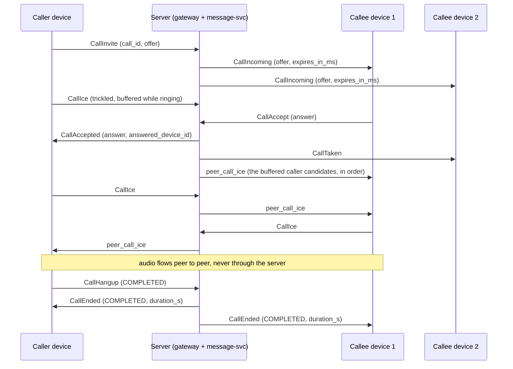

# Voice calls

1:1 WebRTC audio calls between accepted contacts (and between an owned agent and its
owner), signalled over the existing `push.v1` WebSocket. The server carries signalling
only: SDP offers and answers and ICE candidates travel through it, the audio goes peer to
peer (Opus, DTLS-SRTP end to end) and the server never sees it. Design:
[spec 2026-11-03](superpowers/specs/2026-11-03-voice-calls-design.md). Where this guide
and the spec differ, this guide describes what the code does.

- [1. Status](#1-status)
- [2. Enabling calls](#2-enabling-calls)
- [3. Capability advertisement](#3-capability-advertisement)
- [4. Wire frames](#4-wire-frames)
- [5. Error codes](#5-error-codes)
- [6. Call flow](#6-call-flow)
- [7. Client rules](#7-client-rules)
- [8. Limits](#8-limits)
- [9. Privacy](#9-privacy)
- [10. Configuration](#10-configuration)
- [11. Metrics](#11-metrics)

## 1. Status

| Part | Status |
|---|---|
| Signalling (the frames below, the call engine in message-svc, the gateway relay) | available in this release, **off by default** |
| TURN credentials API (`GET /v1/calls/ice-servers`) and the chart's TURN settings | coming |
| Call history | coming |
| push-sdk calls API, bindings and a complete browser recipe | coming |
| Agents in calls (push-agent-bridge voice) | coming |

Until the TURN credentials API ships, clients bring their own ICE servers (public STUN
works for many networks; calls between two symmetric NATs need TURN). Video, group calls,
ringing through push notifications and recording are not available; the wire leaves room
for them (spec §4.8).

## 2. Enabling calls

Calls are off until the operator sets `calls.enabled: true` in the chart, which switches
both the gateway and message-svc (`PUSH_CALLS_ENABLED=1` on each). Enable it only once
**every** gateway and message-svc replica runs a version with calls: during a rollout a
`Call` RPC that lands on an older message-svc answers `UNIMPLEMENTED`, which clients see
as a retryable `CallError UNAVAILABLE`, and devices on older gateways are never reachable.
See [§10](#10-configuration) for the other values.

## 3. Capability advertisement

- A client lists `CAPABILITY_CALLS` in `Identify.capabilities` only if it can take calls
  (it has call UI or a media helper). Only such connections ring.
- `Ready.capabilities` lists what the server offers on this connection: `CAPABILITY_CALLS`
  when the gateway has calls enabled **and** message-svc offers them. Servers from before
  calls never list anything. Hide call UI when `Ready` does not list it.
- A connection is **calls-active** only when both `Identify` and `Ready` list
  `CAPABILITY_CALLS`. Only calls-active connections receive call frames, ring, and may
  send call frames; a call frame on any other connection is answered
  `CallError NOT_AVAILABLE`.
- Right after `Ready`, every calls-active connection receives one `CallSync`.
- A callee with no calls-active device online cannot ring: the invite is answered at once
  with `CallEnded UNREACHABLE`.
- Old clients never receive call frames: they do not advertise the capability.

## 4. Wire frames

All frames are fields of `Frame.body` in
[`frame.proto`](../crates/push-proto/proto/push/v1/frame.proto), which documents every
field. Identifiers are 16-byte UUIDs; `call_id` is a **UUIDv7** the caller chooses for
`CallInvite` (version 7 is enforced) and every later frame of the call names it. Times
(`expires_at`, `answered_at`) are microseconds since the Unix epoch on the server's clock;
use the relative `expires_in_ms` for local timers.

Client to server (every refused frame is answered by a `CallError` with its `call_id`,
never by `Error`):

| Frame | # | Sent by | Effect |
|---|---|---|---|
| `call_invite` (`CallInvite`) | 11 | the caller's device | calls a contact with an audio-only offer; rings their devices, or is answered `CallEnded BUSY`/`UNREACHABLE` |
| `call_accept` (`CallAccept`) | 12 | a ringing callee device | answers with the SDP answer; the first accept wins |
| `call_decline` (`CallDecline`) | 13 | a ringing callee device | refuses the call, reason `DECLINED` (default) or `BUSY` |
| `call_cancel` (`CallCancel`) | 14 | the caller's device | withdraws a ringing call |
| `call_ice` (`CallIce`) | 15 | a party device | one trickled candidate, or `end_of_candidates` |
| `call_hangup` (`CallHangup`) | 16 | a party device | ends the call, reason `COMPLETED` (default) or `FAILED`; while ringing it cancels (caller) or declines (callee) |
| `call_renegotiate` (`CallRenegotiate`) | 17 | a party device, active calls only | a new offer or answer (ICE restart, later media changes) |

Server to client (only calls-active connections receive them):

| Frame | # | Who receives it |
|---|---|---|
| `call_incoming` (`CallIncoming`) | 44 | every calls-active device of the callee: caller, offer, `expires_at`, `expires_in_ms` |
| `call_accepted` (`CallAccepted`) | 45 | the caller's device: the answer and the answering device's id |
| `call_taken` (`CallTaken`) | 46 | the callee's other ringing devices: stop ringing, the call goes on elsewhere |
| `call_ended` (`CallEnded`) | 47 | every device involved: the caller's device, and the callee's ringing devices (while ringing) or answering device (once active), including the device whose frame ended the call; also the immediate answer to an invite that cannot ring |
| `call_error` (`CallError`) | 48 | the device whose frame was refused |
| `call_sync` (`CallSync`) | 49 | each calls-active connection, once after `Ready`: the user's calls as this device sees them |
| `peer_call_ice` (`CallIce`) | 50 | the other party's device: a candidate the peer sent, relayed as is |
| `peer_call_renegotiate` (`CallRenegotiate`) | 51 | the other party's device: a renegotiation the peer sent, relayed as is |

A `CallSync` lists `CallState` entries: `call_id`, `peer_user_id`, `direction` (`IN` or
`OUT`), `status` (`RINGING` or `ACTIVE`), `media`, the offer (incoming ringing calls
only), `expires_at`/`expires_in_ms` (ringing only), `answered_at` (active only) and
`this_device` (the call's device on this side is this device: the caller's device for an
outgoing call, the answering device for an active incoming one, or a ringing device).

## 5. Error codes

`CallError.code` is one of:

| Code | # | When | Retryable |
|---|---|---|---|
| `ERROR_CODE_ALREADY_ANSWERED` | 27 | `CallAccept` or `CallCancel` after a callee device answered | no |
| `ERROR_CODE_CALL_NOT_FOUND` | 28 | no such call for this device in this role: unknown, ended, another user's, or a frame the device may not send (for example `CallRenegotiate` while ringing, `CallIce` from a callee device before its accept). One answer for all: drop the call locally | no |
| `ERROR_CODE_IN_CALL` | 29 | the caller already has a call, ringing or active, on any of their devices | no |
| `ERROR_CODE_CALL_LIMIT` | 30 | the call's cap of `CallIce` or `CallRenegotiate` frames is reached ([§8](#8-limits)) | no |
| `ERROR_CODE_NOT_CONTACT` | 6 | not an accepted contact, a block either way, an agent rule, or no such user: indistinguishable | no |
| `ERROR_CODE_INVALID` | 2 | malformed ids, a `call_id` that is not a UUIDv7, calling oneself, a bad or oversize SDP, video, a bad candidate, a reason the frame does not allow, the same `call_id` invited by another device | no |
| `ERROR_CODE_RATE_LIMITED` | 23 | too many `CallInvite` per hour, with `retry_after_s` | yes, after `retry_after_s` |
| `ERROR_CODE_NOT_AVAILABLE` | 24 | calls are not offered on this connection (not calls-active) | no |
| `ERROR_CODE_UNAVAILABLE` | 9 | Redis or message-svc unavailable, or too many concurrent changes to the call | yes |

Busy and unreachable callees are not errors: the invite is answered `CallEnded BUSY` or
`CallEnded UNREACHABLE`.

## 6. Call flow

The normal flow, a callee with two devices:

How a call ends (`CallEnded.reason`):

| Reason | When | Sent to |
|---|---|---|
| `COMPLETED` | a party sent `CallHangup` (reason `COMPLETED` or absent) after the answer | both party devices, with `duration_s` |
| `MISSED` | nobody answered before ringing timed out (`calls.ringSeconds`), or an accept arrived after it | the caller's device and the ringing devices (a late accepter too) |
| `DECLINED` | a ringing callee device sent `CallDecline` (or `CallHangup`) | the caller's device and the ringing devices |
| `CANCELLED` | the caller sent `CallCancel` (or `CallHangup`) while ringing | the caller's device and the ringing devices |
| `BUSY` | the callee is in a call or ringing for one (immediate answer to the invite), or a ringing device declined with `BUSY` | the caller's device (and the ringing devices for a decline) |
| `FAILED` | a party hung up with `FAILED`, or a party device stayed disconnected longer than `calls.disconnectGraceSeconds` (also the caller's device while ringing) | every device involved (`duration_s` once answered) |
| `UNREACHABLE` | the callee has no calls-active device online (immediate answer to the invite) | the caller's device |

`duration_s` counts whole seconds from the answer to the end and is set only for calls
that were answered. A block does not end a call already ringing or active; it prevents the
next one.

A user has at most one call, ringing or active, across all their devices. Resending a
`CallInvite` with the same `call_id` from the same device while it rings is a harmless
retry; resending `CallAccept` from the answering device sends `CallAccepted` to the caller
again.

## 7. Client rules

- **Only the caller makes the initial offer**, in `CallInvite`. The callee answers in
  `CallAccept`.
- **Renegotiation** (`CallRenegotiate`: ICE restart, later media changes) may come from
  either side once the call is active. Resolve glare with
  [perfect negotiation](https://developer.mozilla.org/en-US/docs/Web/API/WebRTC_API/Perfect_negotiation):
  the **callee is polite**, the caller impolite.
- **Trickle ICE**: send each local candidate as `CallIce` as it is gathered, then one with
  `end_of_candidates: true` and an empty candidate. The caller may trickle while ringing
  (the server buffers up to 32 and hands them to the answering device right after its
  accept). The callee sends `CallAccept` first and its candidates after (a callee
  `CallIce` before the accept is `CALL_NOT_FOUND`).
- **Buffer peer ICE**: `peer_call_ice` may arrive before the client has applied
  `CallAccepted` (caller) or set the remote description (callee). Queue candidates per
  `call_id` and add them once the remote description is set.
- **Ringing**: ring locally for `expires_in_ms` from receipt (not until `expires_at`: the
  device clock may be skewed); stop on `CallTaken` or `CallEnded`.
- **After every reconnect**, read `CallSync`: drop every local call it does not list; a
  listed ringing incoming call can still be answered (its offer is included); for a
  listed `ACTIVE` call with `this_device`, restart ICE with a `CallRenegotiate` offer
  created with `iceRestart`. A party device that stays away longer than the disconnect
  grace ends the call `FAILED`.
- **`CallCancel` answered `ALREADY_ANSWERED`** means the call connected: send
  `CallHangup` to end it.
- **`CALL_NOT_FOUND`**: the call is gone for this device; release its media.
- On `CallEnded`, release the call's media and close the peer connection.

## 8. Limits

| Limit | Value | Refused with |
|---|---|---|
| SDP (offer, answer, renegotiation) | at most 16 KiB (16384 bytes) of UTF-8; lines `<letter>=<value>`, first line `v=0`; at least one `m=audio` and no other `m=` kind (audio only) | `INVALID` |
| ICE candidate | at most 512 bytes of printable ASCII starting with `candidate:` (or empty with `end_of_candidates`); `sdp_mid` at most 32 bytes, `username_fragment` at most 256 | `INVALID` |
| `CallIce` per side per call | 200 | `CALL_LIMIT` |
| Caller `CallIce` buffered before the answer | 32 | `CALL_LIMIT` |
| `CallRenegotiate` per side per call | 20 | `CALL_LIMIT` |
| `CallInvite` per user per hour, refused or not | `calls.attemptsPerHour` (30) | `RATE_LIMITED` with `retry_after_s` |
| Calls per user | one, ringing or active, across all devices | `IN_CALL` (caller) or `CallEnded BUSY` (callee) |

## 9. Privacy

- The server never sees media: audio goes peer to peer, encrypted end to end by
  DTLS-SRTP.
- It relays SDP and ICE candidates as opaque strings, after the contact policy, and only
  to the call's devices: the offer to the callee's ringing devices (in `CallIncoming` and
  `CallSync`), the answer to the caller's device, the callee's candidates only after the
  callee accepted, and the caller's pre-answer candidates only to the answering device
  (ringing devices never receive them). Ringing devices that did not answer never learn
  the caller's addresses from candidates.
- SDP and candidates are kept only in the call's Redis record while the call lives, and
  never appear in logs, metrics or audit lines (the audit records `call.started` and
  `call.ended` with ids, reason and duration only). The gateway never logs WebSocket
  payloads, even at `RUST_LOG=trace`.
- **Use trickle ICE** so the offer carries no candidates: then the callee's ringing
  devices, which receive the offer, learn none of the caller's addresses.
- Once TURN is available, `iceTransportPolicy: "relay"` keeps both sides' IP addresses
  from each other (the peer sees only the relay).

## 10. Configuration

Chart values (validated by the chart and by the services at start):

| Value | Default | Range | Env |
|---|---|---|---|
| `calls.enabled` | `false` | `true` or `false` | `PUSH_CALLS_ENABLED` (`1`/`0`) on the gateway and message-svc |
| `calls.ringSeconds` | `45` | integer 10–120 | `PUSH_CALLS_RING_SECONDS` (message-svc) |
| `calls.disconnectGraceSeconds` | `30` | integer 5–120 | `PUSH_CALLS_DISCONNECT_GRACE_SECONDS` (message-svc) |
| `calls.attemptsPerHour` | `30` | integer 1–1000 | `PUSH_CALLS_ATTEMPTS_PER_HOUR` (gateway) |

## 11. Metrics

message-svc serves Prometheus text (format 0.0.4) at `GET /metrics` on its health
listener (`PUSH_HEALTH_ADDR`, port 8081). The body is empty while calls are disabled.
Labels are reasons, codes and frame kinds only, never call content.

| Metric | Type | Labels |
|---|---|---|
| `push_calls_started_total` | counter | — |
| `push_calls_answered_total` | counter | — |
| `push_calls_ended_total` | counter | `reason`: completed, missed, declined, cancelled, busy, failed, unreachable |
| `push_call_frames_refused_total` | counter | `code`: not_contact, call_not_found, invalid, already_answered, in_call, call_limit, unavailable, not_available |
| `push_call_setup_seconds` | histogram | — (an accept received → `CallAccepted` published) |
| `push_call_signal_seconds` | histogram | `frame`: invite, accept, decline, cancel, ice, hangup, renegotiate (time to handle and publish a call frame) |
| `push_calls_live` | gauge | — (calls ringing or active; absent while Redis does not answer) |

Rate-limited invites are refused by the gateway before they reach message-svc and are not
counted here.
