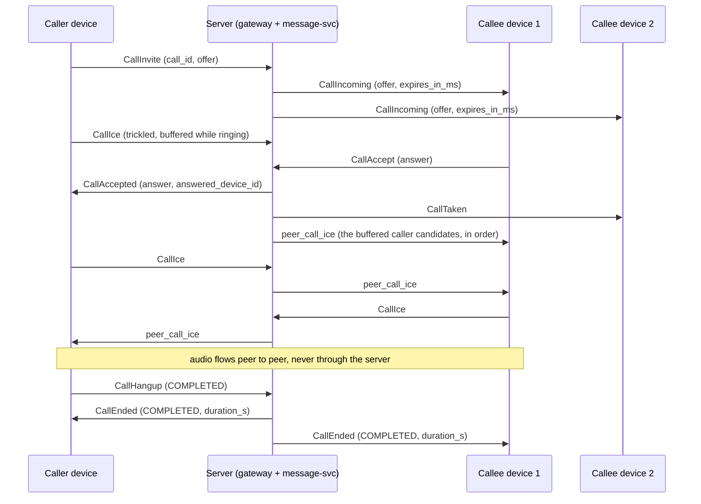
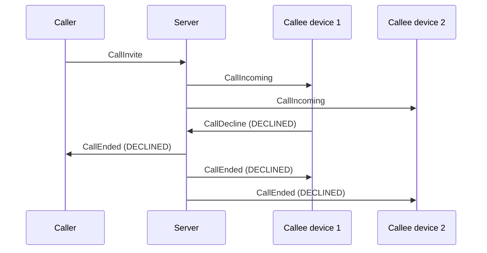
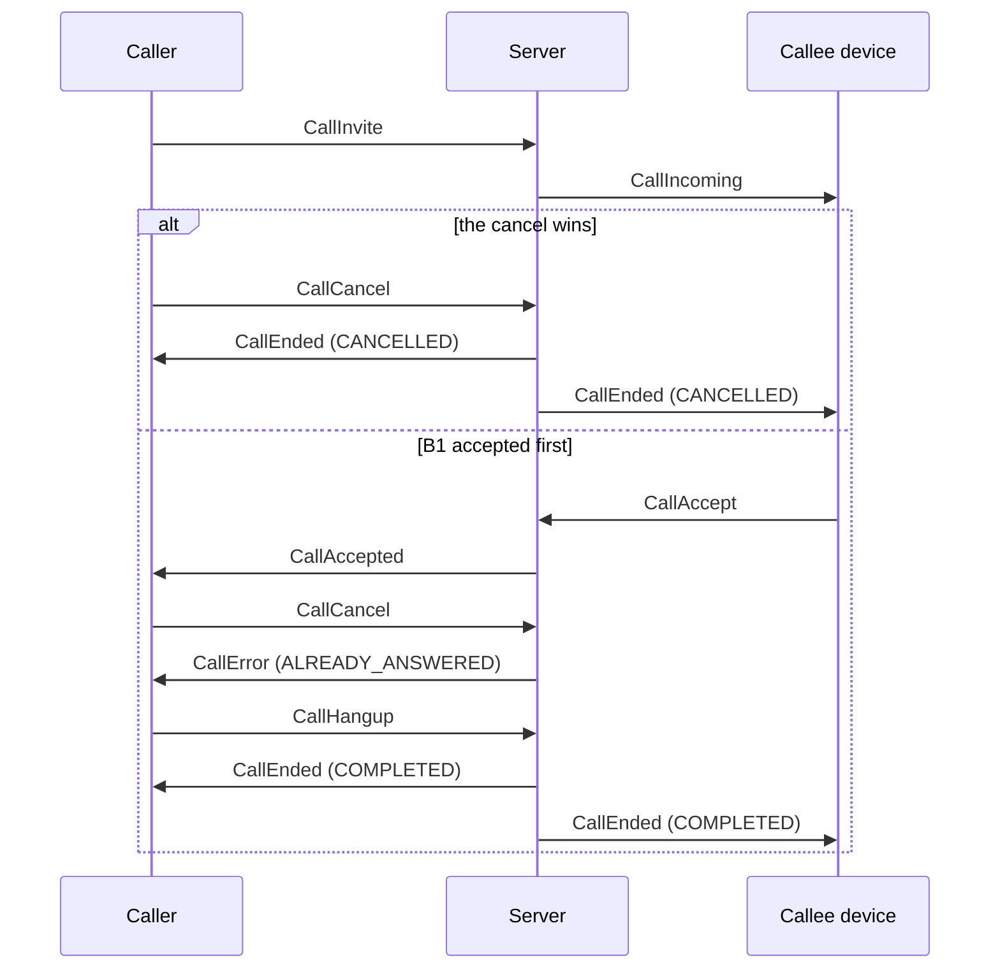
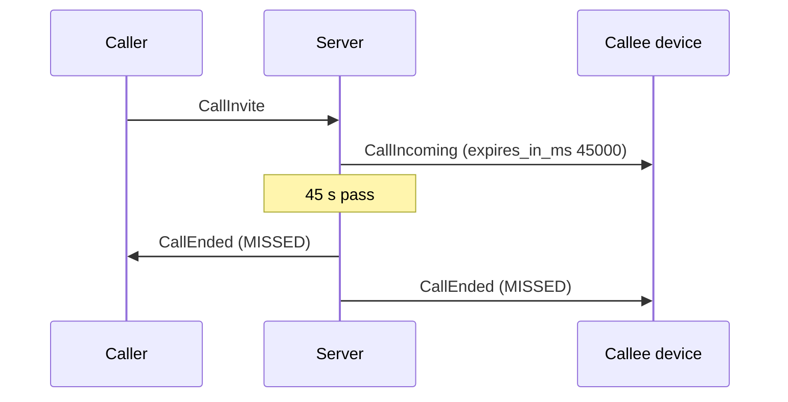
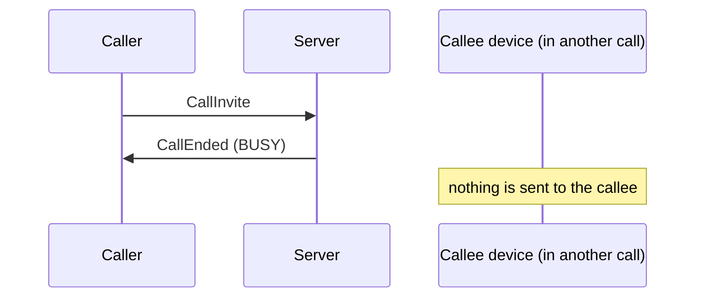
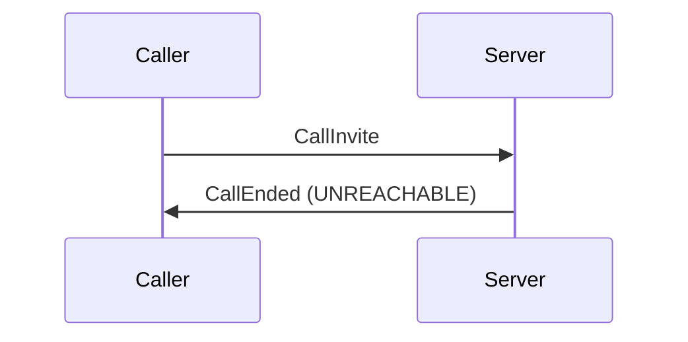
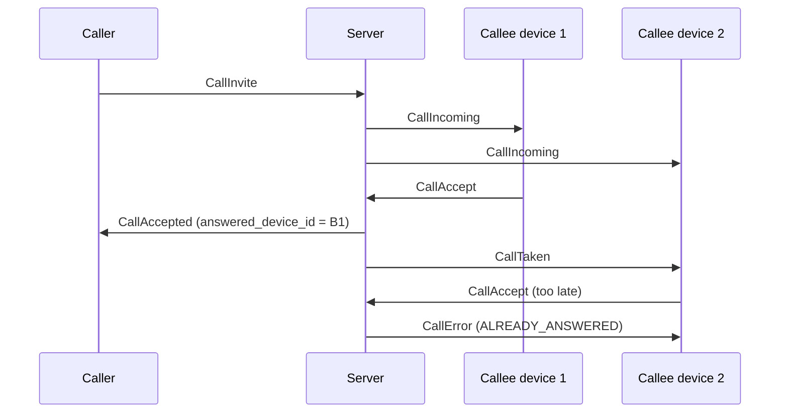
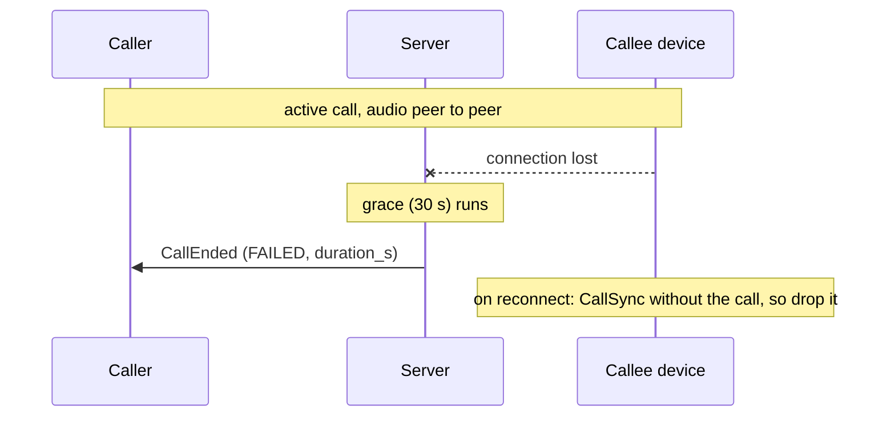
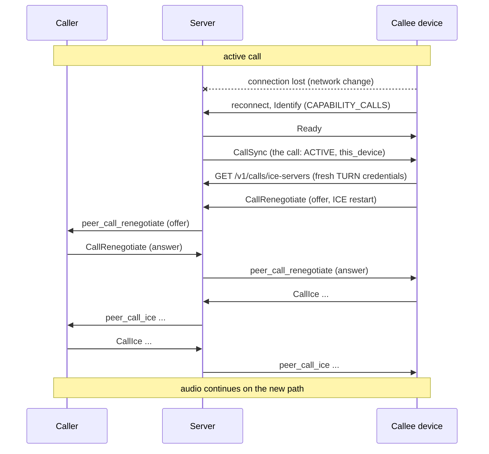
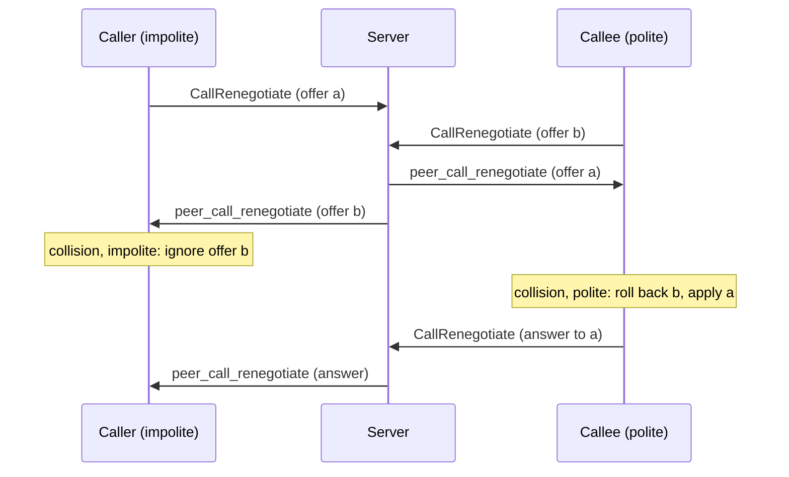

# Voice calls

1:1 WebRTC audio calls between accepted contacts (and between an owned agent and its
owner), signalled over the existing `push.v1` WebSocket. The server carries signalling
only: SDP offers and answers and ICE candidates travel through it, the audio goes peer to
peer (Opus, DTLS-SRTP end to end) and the server never sees it. Design:
[spec 2026-11-03](superpowers/specs/2026-11-03-voice-calls-design.md). Where this guide
and the spec differ, this guide describes what the code does.

- [1. Status](#1-status)
- [2. Enabling calls](#2-enabling-calls)
- [3. Capability advertisement](#3-capability-advertisement)
- [4. Wire frames](#4-wire-frames)
- [5. Error codes](#5-error-codes)
- [6. Call flow](#6-call-flow)
- [7. Client rules](#7-client-rules)
- [8. Limits](#8-limits)
- [9. Privacy](#9-privacy)
- [10. Configuration](#10-configuration)
- [11. Metrics](#11-metrics)
- [12. Call history](#12-call-history)
- [13. TURN](#13-turn)
- [14. Browser recipe](#14-browser-recipe)
- [15. Testing: browser smoke, interoperability, load](#15-testing-browser-smoke-interoperability-load)
- [16. Troubleshooting](#16-troubleshooting)
- [17. Release notes and upgrade guide](#17-release-notes-and-upgrade-guide)
- [18. push-sdk](#18-push-sdk)
- [19. Media helper](#19-media-helper)

## 1. Status

| Part | Status |
|---|---|
| Signalling (the frames below, the call engine in message-svc, the gateway relay) | available in this release, **off by default** |
| TURN credentials API (`GET /v1/calls/ice-servers`), the chart's coturn and `calls.turn` ([§13](#13-turn)) | available in this release, with calls |
| Call history (`GET /v1/calls`, `DELETE /v1/calls/{call_id}`, `CallHistoryChanged`, retention) | available in this release ([§12](#12-call-history)) |
| Browser recipe: a reference page ([`docs/examples/calls`](examples/calls)), its Playwright smoke test and the interoperability checklist ([§14](#14-browser-recipe), [§15](#15-testing-browser-smoke-interoperability-load)) | available in this release |
| push-load `calls` scenario: concurrent calls and setup latency ([§15.3](#153-load)) | available in this release |
| push-sdk calls API ([§18](#18-push-sdk)) | available in this release (Rust; the C and Node bindings follow) |
| push-sdk media helper `MediaCall` (feature `calls-media`: a native WebRTC audio peer, PCM in and out; [§19](#19-media-helper)) | available in this release (Rust) |
| Agents in calls: push-agent-bridge answers its owner's calls (phase 2's bridge voice pipeline, PR 7: transcripts as prompts, spoken replies, barge-in, voice answers to cards; [agent bridge §18](agent-bridge.md#18-voice-calls)) | available in this release (build with `--features voice`) |
| Agents' answering and calling policies (PR 8: `calls.answer: "ask"`, the agent calling its owner with `calls.notify_by_call`, do-not-disturb hours and a rate limit, the tray's call state with Mute agent and Hang up; [agent bridge §18](agent-bridge.md#18-voice-calls)) | available in this release (build with `--features voice`) |
| Agents' voice adapter: speech in a separate, swappable process (`calls.adapter`, [`push-voice-adapter/1`](voice-adapter-protocol.md); calls advertised only while it is ready; [agent bridge §18](agent-bridge.md#voice-adapter)); the bridge carries the audio and has no speech engine of its own (its former built-in speech providers are removed) | available in this release (build with `--features voice`) |

This guide is meant to be enough to build a client without reading the server code. In
short, a browser client:

1. connects the WebSocket and lists `CAPABILITY_CALLS` in `Identify` ([§3](#3-capability-advertisement));
2. fetches `GET /v1/calls/ice-servers` for each call and builds an `RTCPeerConnection` with
   it ([§13.1](#131-the-api));
3. as the caller, puts its offer in `CallInvite`; as the callee, its answer in
   `CallAccept` ([§6](#6-call-flow));
4. trickles candidates with `CallIce`, queueing the peer's until the remote description is
   set ([§7](#7-client-rules));
5. reads `CallSync` after every reconnect and restarts ICE for its active call;
6. releases media on `CallEnded`, `CallTaken` or `CALL_NOT_FOUND`.

[`docs/examples/calls/calls.js`](examples/calls/calls.js) does all of this in about 500
lines ([§14](#14-browser-recipe)).

Clients get their ICE servers (STUN and TURN, with short-lived credentials) from
`GET /v1/calls/ice-servers` ([§13.1](#131-the-api)). Video, group calls,
ringing through push notifications and recording are not available; the wire leaves room
for them (spec §4.8).

## 2. Enabling calls

Calls are off until the operator sets `calls.enabled: true` in the chart, which switches
both the gateway and message-svc (`PUSH_CALLS_ENABLED=1` on each). Enable it only once
**every** gateway and message-svc replica runs a version with calls: during a rollout a
`Call` RPC that lands on an older message-svc answers `UNIMPLEMENTED`, which clients see
as a retryable `CallError UNAVAILABLE`, and devices on older gateways are never reachable.
See [§10](#10-configuration) for the other values.

## 3. Capability advertisement

- A client lists `CAPABILITY_CALLS` in `Identify.capabilities` only if it can take calls
  (it has call UI or a media helper). Only such connections ring.
- `Ready.capabilities` lists what the server offers on this connection: `CAPABILITY_CALLS`
  when the gateway has calls enabled **and** message-svc offers them. Servers from before
  calls never list anything. Hide call UI when `Ready` does not list it.
- A connection is **calls-active** only when both `Identify` and `Ready` list
  `CAPABILITY_CALLS`. Only calls-active connections receive call frames, ring, and may
  send call frames; a call frame on any other connection is answered
  `CallError NOT_AVAILABLE`.
- Right after `Ready`, every calls-active connection receives one `CallSync`.
- A callee with no calls-active device online cannot ring: the invite is answered at once
  with `CallEnded UNREACHABLE`.
- Old clients never receive call frames: they do not advertise the capability.

## 4. Wire frames

All frames are fields of `Frame.body` in
[`frame.proto`](../crates/push-proto/proto/push/v1/frame.proto), which documents every
field. Identifiers are 16-byte UUIDs; `call_id` is a **UUIDv7** the caller chooses for
`CallInvite` (version 7 is enforced) and every later frame of the call names it. Times
(`expires_at`, `answered_at`) are microseconds since the Unix epoch on the server's clock;
use the relative `expires_in_ms` for local timers.

Client to server (every refused frame is answered by a `CallError` with its `call_id`,
never by `Error`):

| Frame | # | Sent by | Effect |
|---|---|---|---|
| `call_invite` (`CallInvite`) | 11 | the caller's device | calls a contact with an audio-only offer; rings their devices, or is answered `CallEnded BUSY`/`UNREACHABLE` |
| `call_accept` (`CallAccept`) | 12 | a ringing callee device | answers with the SDP answer; the first accept wins |
| `call_decline` (`CallDecline`) | 13 | a ringing callee device | refuses the call, reason `DECLINED` (default) or `BUSY` |
| `call_cancel` (`CallCancel`) | 14 | the caller's device | withdraws a ringing call |
| `call_ice` (`CallIce`) | 15 | a party device | one trickled candidate, or `end_of_candidates` |
| `call_hangup` (`CallHangup`) | 16 | a party device | ends the call, reason `COMPLETED` (default) or `FAILED`; while ringing it cancels (caller) or declines (callee) |
| `call_renegotiate` (`CallRenegotiate`) | 17 | a party device, active calls only | a new offer or answer (ICE restart, later media changes) |

Server to client (only calls-active connections receive them):

| Frame | # | Who receives it |
|---|---|---|
| `call_incoming` (`CallIncoming`) | 44 | every calls-active device of the callee: caller, offer, `expires_at`, `expires_in_ms` |
| `call_accepted` (`CallAccepted`) | 45 | the caller's device: the answer and the answering device's id |
| `call_taken` (`CallTaken`) | 46 | the callee's other ringing devices: stop ringing, the call goes on elsewhere |
| `call_ended` (`CallEnded`) | 47 | every device involved: the caller's device, and the callee's ringing devices (while ringing) or answering device (once active), including the device whose frame ended the call; also the immediate answer to an invite that cannot ring |
| `call_error` (`CallError`) | 48 | the device whose frame was refused |
| `call_sync` (`CallSync`) | 49 | each calls-active connection, once after `Ready`: the user's calls as this device sees them |
| `call_history_changed` (`CallHistoryChanged`) | 52 | every calls-active device of the user, when a call of theirs ended or they hid one ([§12](#12-call-history)) |
| `peer_call_ice` (`CallIce`) | 50 | the other party's device: a candidate the peer sent, relayed as is |
| `peer_call_renegotiate` (`CallRenegotiate`) | 51 | the other party's device: a renegotiation the peer sent, relayed as is |

A `CallSync` lists `CallState` entries: `call_id`, `peer_user_id`, `direction` (`IN` or
`OUT`), `status` (`RINGING` or `ACTIVE`), `media`, the offer (incoming ringing calls
only), `expires_at`/`expires_in_ms` (ringing only), `answered_at` (active only) and
`this_device` (the call's device on this side is this device: the caller's device for an
outgoing call, the answering device for an active incoming one, or a ringing device).

### 4.1 Field reference

Field names are as in `frame.proto` (protobuf.js with `keepCase: true` keeps them; most
generators turn them into camelCase). `bytes` ids are 16-byte UUIDs; proto3 `optional`
fields can be absent, which is not the same as zero.

| Message | Field (#) | Type | Meaning |
|---|---|---|---|
| `Identify` | `capabilities` (2) | `repeated Capability` | list `CAPABILITY_CALLS` to take calls |
| `Ready` | `capabilities` (4) | `repeated Capability` | `CAPABILITY_CALLS` when the server offers calls on this connection |
| `CallInvite` | `call_id` (1) | bytes | a new UUIDv7 chosen by the caller |
| | `callee_user_id` (2) | bytes | the user to call (not yourself) |
| | `offer_sdp` (3) | string | the SDP offer, audio only, ≤ 16384 bytes |
| | `media` (4) | `repeated CallMedia` | exactly `[CALL_MEDIA_AUDIO]` |
| `CallAccept` | `call_id` (1), `answer_sdp` (2) | bytes, string | the SDP answer, audio only, ≤ 16384 bytes |
| `CallDecline` | `call_id` (1), `reason` (2, optional) | bytes, `CallEndReason` | `DECLINED` (default) or `BUSY` |
| `CallCancel` | `call_id` (1) | bytes | |
| `CallIce` (also `peer_call_ice`) | `call_id` (1) | bytes | |
| | `candidate` (2) | string | `RTCIceCandidate.candidate` (`candidate:…`, ≤ 512 bytes); empty with `end_of_candidates` |
| | `sdp_mid` (3, optional) | string | `RTCIceCandidate.sdpMid`, ≤ 32 bytes |
| | `sdp_mline_index` (4, optional) | uint32 | `RTCIceCandidate.sdpMLineIndex` |
| | `end_of_candidates` (5) | bool | no more candidates of this side for this ICE generation |
| | `username_fragment` (6, optional) | string | `RTCIceCandidate.usernameFragment`, ≤ 256 bytes; tells candidates of an ICE restart apart |
| `CallHangup` | `call_id` (1), `reason` (2, optional) | bytes, `CallEndReason` | `COMPLETED` (default) or `FAILED` |
| `CallRenegotiate` (also `peer_call_renegotiate`) | `call_id` (1), `sdp` (2), `type` (3) | bytes, string, `CallSdpType` | `CALL_SDP_TYPE_OFFER` or `CALL_SDP_TYPE_ANSWER` |
| `CallIncoming` | `call_id` (1), `caller_user_id` (2) | bytes | |
| | `offer_sdp` (3), `media` (4) | string, `repeated CallMedia` | the caller's offer |
| | `expires_at` (5) | int64 | ringing ends (µs since the epoch, server clock): display only |
| | `expires_in_ms` (6) | uint32 | ringing lasts this long from receipt: use it for the timer |
| `CallAccepted` | `call_id` (1), `answer_sdp` (2), `answered_device_id` (3) | bytes, string, bytes | the callee's answer and the device that gave it |
| `CallTaken` | `call_id` (1) | bytes | another device of yours answered |
| `CallEnded` | `call_id` (1), `reason` (2), `duration_s` (3, optional) | bytes, `CallEndReason`, uint32 | `duration_s` only for answered calls |
| `CallError` | `call_id` (1), `code` (2), `message` (3), `retryable` (4), `retry_after_s` (5, optional) | bytes, `ErrorCode`, string, bool, uint32 | [§5](#5-error-codes) |
| `CallSync` | `calls` (1) | `repeated CallState` | the user's calls as this device sees them |
| `CallState` | `call_id` (1), `peer_user_id` (2), `direction` (3), `status` (4), `media` (5) | | `CALL_DIRECTION_IN`/`OUT`, `CALL_STATUS_RINGING`/`ACTIVE` |
| | `offer_sdp` (6, optional) | string | incoming ringing calls only |
| | `expires_at` (7), `expires_in_ms` (8) (optional) | int64, uint32 | ringing only |
| | `answered_at` (9, optional) | int64 | active only |
| | `this_device` (10) | bool | this device is the call's device on this side |
| `CallHistoryChanged` | `latest_ended_at` (1, optional) | int64 | [§12](#12-call-history) |

Enums: `Capability` (`CAPABILITY_CALLS` = 1), `CallMedia` (`AUDIO` = 1; `VIDEO` = 2 is
refused in this release), `CallEndReason` (`COMPLETED` 1, `MISSED` 2, `DECLINED` 3,
`CANCELLED` 4, `BUSY` 5, `FAILED` 6, `UNREACHABLE` 7), `CallSdpType` (`OFFER` 1, `ANSWER`
2), `CallDirection` (`IN` 1, `OUT` 2), `CallStatus` (`RINGING` 1, `ACTIVE` 2). Treat
unknown enum values and unknown frames as "ignore": later releases add values (video,
group calls) without breaking older clients.

## 5. Error codes

`CallError.code` is one of:

| Code | # | When | Retryable |
|---|---|---|---|
| `ERROR_CODE_ALREADY_ANSWERED` | 27 | `CallAccept` or `CallCancel` after a callee device answered | no |
| `ERROR_CODE_CALL_NOT_FOUND` | 28 | no such call for this device in this role: unknown, ended, another user's, or a frame the device may not send (for example `CallRenegotiate` while ringing, `CallIce` from a callee device before its accept). One answer for all: drop the call locally | no |
| `ERROR_CODE_IN_CALL` | 29 | the caller already has a call, ringing or active, on any of their devices | no |
| `ERROR_CODE_CALL_LIMIT` | 30 | the call's cap of `CallIce` or `CallRenegotiate` frames is reached ([§8](#8-limits)) | no |
| `ERROR_CODE_NOT_CONTACT` | 6 | not an accepted contact, a block either way, an agent rule, or no such user: indistinguishable | no |
| `ERROR_CODE_INVALID` | 2 | malformed ids, a `call_id` that is not a UUIDv7, calling oneself, a bad or oversize SDP, video, a bad candidate, a reason the frame does not allow, the same `call_id` invited by another device | no |
| `ERROR_CODE_RATE_LIMITED` | 23 | too many `CallInvite` per hour, with `retry_after_s` | yes, after `retry_after_s` |
| `ERROR_CODE_NOT_AVAILABLE` | 24 | calls are not offered on this connection (not calls-active) | no |
| `ERROR_CODE_UNAVAILABLE` | 9 | Redis or message-svc unavailable, or too many concurrent changes to the call | yes |

Busy and unreachable callees are not errors: the invite is answered `CallEnded BUSY` or
`CallEnded UNREACHABLE`.

## 6. Call flow

The normal flow, a callee with two devices:



How a call ends (`CallEnded.reason`):

| Reason | When | Sent to |
|---|---|---|
| `COMPLETED` | a party sent `CallHangup` (reason `COMPLETED` or absent) after the answer | both party devices, with `duration_s` |
| `MISSED` | nobody answered before ringing timed out (`calls.ringSeconds`), or an accept arrived after it | the caller's device and the ringing devices (a late accepter too) |
| `DECLINED` | a ringing callee device sent `CallDecline` (or `CallHangup`) | the caller's device and the ringing devices |
| `CANCELLED` | the caller sent `CallCancel` (or `CallHangup`) while ringing | the caller's device and the ringing devices |
| `BUSY` | the callee is in a call or ringing for one (immediate answer to the invite), or a ringing device declined with `BUSY` | the caller's device (and the ringing devices for a decline) |
| `FAILED` | a party hung up with `FAILED`, or a party device stayed disconnected longer than `calls.disconnectGraceSeconds` (also the caller's device while ringing) | every device involved (`duration_s` once answered) |
| `UNREACHABLE` | the callee has no calls-active device online (immediate answer to the invite) | the caller's device |

`duration_s` counts whole seconds from the answer to the end and is set only for calls
that were answered. A block does not end a call already ringing or active; it prevents the
next one.

A user has at most one call, ringing or active, across all their devices. Resending a
`CallInvite` with the same `call_id` from the same device while it rings is a harmless
retry; resending `CallAccept` from the answering device sends `CallAccepted` to the caller
again.

### 6.1 Every ending, step by step

In the diagrams `A` is the caller's device, `S` the server, `B1`/`B2` the callee's
devices. Frames the server sends to several devices are sent to each of them.

**Declined.** A ringing device refuses (`CallDecline`, or `CallHangup` while ringing). A
decline with `reason: BUSY` (the user is busy elsewhere, for example in a call in another
app) ends the call `BUSY` instead.



**Cancelled.** The caller gives up while it rings (`CallCancel`, or `CallHangup`). If an
accept won the race, the cancel is answered `CallError ALREADY_ANSWERED`: the call is
connected, hang it up.



**Missed.** Nobody answers within `calls.ringSeconds` (45 s). An accept that arrives after
the deadline ends the call `MISSED` too, for the late accepter as well. Clients also stop
ringing locally after `expires_in_ms`, in case the `CallEnded` is lost.



**Busy.** The callee is in a call or ringing for one, on any device: the invite is
answered at once and nothing rings. A caller that already has a call gets `CallError
IN_CALL` instead.



**Unreachable.** No device of the callee is calls-active (offline, or only clients without
call support): the invite is answered at once. The callee gets no history row for it.



**Taken on another device.** The first accept wins; the other ringing devices stop.
A second accept is refused.



**Failed: a disconnect longer than the grace.** A party device's connection drops (the
gateway sees the close, or the heartbeat times out after 2.5 heartbeats) and it does not
come back within `calls.disconnectGraceSeconds` (30 s). The same applies to the caller
while it rings. A party can also end a call `FAILED` itself (`CallHangup` with
`reason: FAILED`, for example when ICE never connects).



**Reconnect within the grace: CallSync and an ICE restart.** Media is peer to peer and
usually survives a signalling drop. After reconnecting, the device reads `CallSync`; for
its active call (`this_device`) it fetches fresh ICE servers, calls
`setConfiguration()`, creates an offer with `iceRestart: true` and sends it as
`CallRenegotiate`. (Create the offer explicitly: `restartIce()` relies on
`negotiationneeded`, which does not fire while an offer is pending, for example for a
caller that missed `CallAccepted` while it was away; the new offer replaces that one.)
Either side may restart; if both do at once, perfect negotiation resolves it
([§7](#7-client-rules)).



**Renegotiation glare.** Both sides send an offer at once. The impolite caller ignores
the callee's offer and keeps its own; the polite callee rolls its own back, answers the
caller's offer, and renegotiates again later if it still needs to.



## 7. Client rules

- **Only the caller makes the initial offer**, in `CallInvite`. The callee answers in
  `CallAccept`.
- **Renegotiation** (`CallRenegotiate`: ICE restart, later media changes) may come from
  either side once the call is active. Resolve glare with
  [perfect negotiation](https://developer.mozilla.org/en-US/docs/Web/API/WebRTC_API/Perfect_negotiation):
  the **callee is polite**, the caller impolite.
- **Trickle ICE**: send each local candidate as `CallIce` as it is gathered, then one with
  `end_of_candidates: true` and an empty candidate. The caller may trickle while ringing
  (the server buffers up to 32 and hands them to the answering device right after its
  accept). The callee sends `CallAccept` first and its candidates after (a callee
  `CallIce` before the accept is `CALL_NOT_FOUND`).
- **Buffer peer ICE**: `peer_call_ice` may arrive before the client has applied
  `CallAccepted` (caller) or set the remote description (callee). Queue candidates per
  `call_id` and add them once the remote description is set.
- **Ringing**: ring locally for `expires_in_ms` from receipt (not until `expires_at`: the
  device clock may be skewed); stop on `CallTaken` or `CallEnded`.
- **After every reconnect**, read `CallSync`: drop every local call it does not list; a
  listed ringing incoming call can still be answered (its offer is included); for a
  listed `ACTIVE` call with `this_device`, restart ICE with a `CallRenegotiate` offer
  created with `iceRestart`. A party device that stays away longer than the disconnect
  grace ends the call `FAILED`.
- **`CallCancel` answered `ALREADY_ANSWERED`** means the call connected: send
  `CallHangup` to end it.
- **`CALL_NOT_FOUND`**: the call is gone for this device; release its media.
- On `CallEnded`, release the call's media and close the peer connection.
- **Offer/answer roles in short**: the initial offer is the caller's (`CallInvite`), the
  initial answer the callee's (`CallAccept`); never send `CallRenegotiate` before the call
  is active (it is `CALL_NOT_FOUND` while ringing). Ignore `negotiationneeded` until the
  call is active: browsers fire it for the first `addTrack`, which the invite already
  covers.
- **Perfect negotiation in code** (what [`calls.js`](examples/calls/calls.js) does): keep
  `makingOffer` while creating a renegotiation offer; on `peer_call_renegotiate` with an
  offer, `collision = makingOffer || pc.signalingState !== "stable"`; the caller
  (impolite) drops a colliding offer, the callee (polite) applies it with
  `setRemoteDescription` (which rolls back its own) and answers with
  `setLocalDescription()` sent as `CallRenegotiate` type `ANSWER`. Ignore
  `addIceCandidate` errors for candidates of an offer you ignored.
- **ICE restarts** make new ICE credentials: send `username_fragment` with each candidate
  so the peer can match candidates to the right generation, and send `end_of_candidates`
  once per generation. Fetch new ICE servers first: TURN credentials expire after
  `calls.turn.ttlSeconds`.
- **Restart ICE also when the path breaks**: on `connectionState` `failed` (or
  `disconnected` for longer than a few seconds) during an active call, restart ICE.
- **One call per user**: your own other devices cannot place or take a second call while
  you are in one (`IN_CALL`, `BUSY`); show that instead of an error.
- **Token refresh**: answer `AuthExpiring` with `ReAuth` as for messaging; a closed
  connection (4002) only starts the disconnect grace, so reconnect with a fresh token
  quickly.

## 8. Limits

| Limit | Value | Refused with |
|---|---|---|
| SDP (offer, answer, renegotiation) | at most 16 KiB (16384 bytes) of UTF-8; lines `<letter>=<value>`, first line `v=0`; at least one `m=audio` and no other `m=` kind (audio only) | `INVALID` |
| ICE candidate | at most 512 bytes of printable ASCII starting with `candidate:` (or empty with `end_of_candidates`); `sdp_mid` at most 32 bytes, `username_fragment` at most 256 | `INVALID` |
| `CallIce` per side per call | 200 | `CALL_LIMIT` |
| Caller `CallIce` buffered before the answer | 32 | `CALL_LIMIT` |
| `CallRenegotiate` per side per call | 20 | `CALL_LIMIT` |
| `CallInvite` per user per hour, refused or not | `calls.attemptsPerHour` (30) | `RATE_LIMITED` with `retry_after_s` |
| Calls per user | one, ringing or active, across all devices | `IN_CALL` (caller) or `CallEnded BUSY` (callee) |

## 9. Privacy

- The server never sees media: audio goes peer to peer, encrypted end to end by
  DTLS-SRTP.
- It relays SDP and ICE candidates as opaque strings, after the contact policy, and only
  to the call's devices: the offer to the callee's ringing devices (in `CallIncoming` and
  `CallSync`), the answer to the caller's device, the callee's candidates only after the
  callee accepted, and the caller's pre-answer candidates only to the answering device
  (ringing devices never receive them). Ringing devices that did not answer never learn
  the caller's addresses from candidates.
- SDP and candidates are kept only in the call's Redis record while the call lives, and
  never appear in logs, metrics or audit lines (the audit records `call.started` and
  `call.ended` with ids, reason and duration only). The gateway never logs WebSocket
  payloads, even at `RUST_LOG=trace`.
- **Use trickle ICE** so the offer carries no candidates: then the callee's ringing
  devices, which receive the offer, learn none of the caller's addresses.
- `iceTransportPolicy: "relay"` with the servers of `GET /v1/calls/ice-servers` keeps
  both sides' IP addresses from each other (the peer sees only the relay). TURN
  credentials name the user they were minted for and are never logged.
- Call history holds ids, times, direction, duration and outcome only (never SDP,
  candidates or addresses). Each participant has a row of their own; only they read or hide
  it ([§12](#12-call-history)). Rows are deleted after `calls.historyDays` (90 days).

## 10. Configuration

Chart values (validated by the chart and by the services at start):

| Value | Default | Range | Env |
|---|---|---|---|
| `calls.enabled` | `false` | `true` or `false` | `PUSH_CALLS_ENABLED` (`1`/`0`) on the gateway and message-svc |
| `calls.ringSeconds` | `45` | integer 10–120 | `PUSH_CALLS_RING_SECONDS` (message-svc) |
| `calls.disconnectGraceSeconds` | `30` | integer 5–120 | `PUSH_CALLS_DISCONNECT_GRACE_SECONDS` (message-svc) |
| `calls.attemptsPerHour` | `30` | integer 1–1000 | `PUSH_CALLS_ATTEMPTS_PER_HOUR` (gateway) |
| `calls.historyDays` | `90` | integer 1–3650 | `PUSH_CALLS_HISTORY_DAYS` (message-svc): call history retention, applied whether calls are enabled or not |
| `calls.turn.*` | `mode: internal` | see [§13.3](#133-chart-values) | `PUSH_TURN_*` (auth-svc), the coturn objects |

The chart refuses an invalid value naming it, for example `"calls.historyDays must be an integer from 1 to 3650"`; the services refuse it at start naming the variable.

### 10.1 Validation messages

`helm install`/`upgrade` stops with one of these (`calls.turn.*` is validated when
`calls.enabled` is true, `calls.turn.mode` always):

| Value | Message |
|---|---|
| `calls.enabled` | `calls.enabled must be true or false` |
| `calls.ringSeconds`, `disconnectGraceSeconds`, `attemptsPerHour`, `historyDays` | `calls.<name> must be an integer from <min> to <max>` |
| `calls.turn.mode` | `calls.turn.mode must be internal, external or stun-only` |
| `calls.turn.ttlSeconds` | `calls.turn.ttlSeconds must be an integer from 60 to 86400` |
| `calls.turn.stunUrls` | `calls.turn.stunUrls must be a list of stun: or stuns: URLs`; with `stun-only`: `calls.turn.stunUrls must not be empty with calls.turn.mode stun-only` |
| `calls.turn.internal.enabled` | `calls.turn.internal.enabled must be true or false` |
| `calls.turn.internal.publicHost` | `calls.turn.internal.publicHost must be the DNS name or IP address clients reach coturn at` |
| `calls.turn.internal.realm` | `calls.turn.internal.realm must be empty or a DNS-like name` |
| `calls.turn.internal.externalIp` | `calls.turn.internal.externalIp must be empty or an IP address`; missing: `calls.turn.internal.externalIp must be set (or calls.turn.internal.service.loadBalancerIP, or an IP address as publicHost): coturn advertises it as its relay address` |
| `calls.turn.internal.ports.*` | `calls.turn.internal.ports.<udp\|tcp\|tls> must be an integer from 1 to 65535`; `calls.turn.internal.ports.tls must differ from calls.turn.internal.ports.tcp`; `calls.turn.internal.ports.<name> must not be within calls.turn.internal.relayPortRange` |
| `calls.turn.internal.relayPortRange` | `calls.turn.internal.relayPortRange must be "<min>-<max>" with 1024 <= min <= max <= 65535 and at most 500 ports` |
| `calls.turn.internal.tlsSecret` | `calls.turn.internal.tlsSecret must be empty or a Secret name` |
| `calls.turn.internal.service.*` | `calls.turn.internal.service.type must be LoadBalancer or ClusterIP`; `calls.turn.internal.service.annotations must be a string-valued annotation map`; `calls.turn.internal.service.loadBalancerIP must be empty or an IP address` |
| `calls.turn.internal.resources` | `calls.turn.internal.resources must be a map of Kubernetes container resources` |
| `calls.turn.internal.deniedPeerCidrs` | empty: `calls.turn.internal.deniedPeerCidrs must list the cluster's pod and service CIDRs`; a bad entry: `calls.turn.internal.deniedPeerCidrs must list the cluster's pod and service CIDRs (network addresses such as 10.244.0.0/16 or fd00:10:244::/56; at least /8 for IPv4, /16 for IPv6, not starting at ::), not <value>`; a malformed range: `files/coturn/denied-peers.txt or calls.turn.internal.deniedPeerCidrs holds "<value>", which is not a CIDR` |
| `calls.turn.internal.quotas.*` | `calls.turn.internal.quotas.<user\|total\|maxBps> must be an integer from <min> to <max>` |
| `calls.turn.internal.image` | `calls.turn.internal.image must be <repository>:<tag>@sha256:<64 hex digits>` |
| `calls.turn.internal.metricsPeers` | `calls.turn.internal.metricsPeers requires namespaceSelector and podSelector as non-empty label maps on every peer` |
| `calls.turn.external.provider` | `calls.turn.external.provider must be generic, cloudflare or twilio` |
| `calls.turn.external.urls` | `calls.turn.external.urls must be a non-empty list of turn: or turns: URLs` |
| `calls.turn.external.*Secret`, `sharedSecret` | `<value> must name a key of the Secret, not hold the secret`; with `secrets.volume`: `<value> must be empty with secrets.volume: the file comes from secrets.files.<key>`; `external` without a consumer-managed Secret: `calls.turn.mode external needs the provider's secret in a consumer-managed Secret: set secrets.existingSecret or secrets.volume` |
| `calls.turn.external.cloudflare.keyId` | `calls.turn.external.cloudflare.keyId must be set to the TURN key id (1 to 64 letters and digits)` |
| `calls.turn.external.twilio.accountSid` | `calls.turn.external.twilio.accountSid must be AC followed by 32 hexadecimal digits` |

The services check their variables again at start and stop with an error that names the
variable and the rule, for example `PUSH_CALLS_RING_SECONDS` (10 to 120),
`PUSH_CALLS_DISCONNECT_GRACE_SECONDS` (5 to 120), `PUSH_CALLS_ATTEMPTS_PER_HOUR` (1 to
1000), `PUSH_CALLS_HISTORY_DAYS` (1 to 3650), `PUSH_CALLS_ENABLED` (`1` or `0`),
`PUSH_TURN_*` ([§13.3](#133-chart-values)); secret values are never echoed.

## 11. Metrics

message-svc serves Prometheus text (format 0.0.4) at `GET /metrics` on its health
listener (`PUSH_HEALTH_ADDR`, port 8081). While calls are disabled it holds only the call
history families.
Labels are reasons, codes and frame kinds only, never call content.

| Metric | Type | Labels |
|---|---|---|
| `push_calls_started_total` | counter | — |
| `push_calls_answered_total` | counter | — |
| `push_calls_ended_total` | counter | `reason`: completed, missed, declined, cancelled, busy, failed, unreachable |
| `push_call_frames_refused_total` | counter | `code`: not_contact, call_not_found, invalid, already_answered, in_call, call_limit, unavailable |
| `push_call_setup_seconds` | histogram | — (an accept received → `CallAccepted` published) |
| `push_call_signal_seconds` | histogram | `frame`: invite, accept, decline, cancel, ice, hangup, renegotiate (time to handle and publish a call frame) |
| `push_calls_live` | gauge | — (calls ringing or active; absent while Redis does not answer) |
| `push_call_history_rows_deleted_total` | counter | — (rows deleted by the retention purge; also with calls disabled) |
| `push_call_history_write_failures_total` | counter | — (ended calls whose history rows could not be stored after 3 attempts; also with calls disabled) |

Rate-limited invites are refused by the gateway before they reach message-svc and are not
counted here.

auth-svc serves its TURN credential counters the same way, at `GET /metrics` on its
health port (8081; empty without TURN settings), labelled by `mode` (`internal`,
`generic`, `cloudflare`, `twilio`, `stun-only`) only:

| Metric | Type | Labels |
|---|---|---|
| `push_turn_credentials_issued_total` | counter | `mode` (ICE server lists handed out) |
| `push_turn_credentials_failures_total` | counter | `mode` (requests answered `turn_unavailable`) |
| `push_turn_provider_requests_total` | counter | `provider`, `outcome`: `ok`, `error` (cloudflare and twilio: calls to the provider; the rest were served from memory) |

coturn's own allocations and relayed traffic: [§13.4](#134-coturn-in-the-chart).

## 12. Call history

Calls are kept apart from conversations: nothing about a call is ever written into a
conversation (there are no "missed call" messages). Instead each participant has a call
history, served by auth-svc with the same access token as the rest of the HTTP API.

**What is recorded.** When a call ends, message-svc stores one row per participant: the
caller's (`direction: "out"`) always, and the callee's (`direction: "in"`) for every
outcome except `unreachable` (the callee never saw that call). Invites answered at once
with `CallEnded BUSY` are recorded too, for both sides; `UNREACHABLE` only for the caller.
Ringing and active calls are not in the history; they are in `CallSync`. The `outcome` is
the `CallEnded.reason` the call ended with.

### `GET /v1/calls`

```
GET /v1/calls?before=<cursor>&since=<cursor>&limit=50
Authorization: Bearer <access token>
```

All parameters are optional. The answer lists the caller's own calls that they did not
hide, **newest first** (by end time, then call id):

```json
{
  "calls": [
    {
      "call_id": "01937a4e-…",
      "peer_user_id": "01936f02-…",
      "direction": "in",
      "started_at": "2026-11-03T17:41:05.120Z",
      "answered_at": "2026-11-03T17:41:09.002Z",
      "ended_at": "2026-11-03T17:43:10.877Z",
      "duration_s": 121,
      "outcome": "completed",
      "cursor": "MTc2MjE5MTc5MDg3NzAwMDowMTkzN2E0ZS0…"
    }
  ],
  "next": "MTc2MjE5MTc5MDg3NzAwMDowMTkzN2E0ZS0…"
}
```

| Field | Meaning |
|---|---|
| `call_id` | the call's id (the `call_id` of its frames) |
| `peer_user_id` | the other participant |
| `direction` | `out`: you called; `in`: you were called |
| `started_at` | when the call was invited (RFC 3339, UTC, milliseconds; server clock) |
| `answered_at` | when it was answered; absent for calls never answered |
| `ended_at` | when it ended |
| `duration_s` | whole seconds from the answer to the end; `0` for calls never answered |
| `outcome` | `completed`, `missed`, `declined`, `cancelled`, `busy`, `failed` or `unreachable` (as `CallEnded.reason`) |
| `cursor` | this call's position, for `before` and `since` |
| `next` | present only when the page is full (`limit` calls): the last call's cursor; ask again with `before=<next>` for older calls |

- `limit`: 1 to 100, default 50.
- `before=<cursor>`: only calls strictly older than that position (paging back).
- `since=<cursor>`: only calls strictly newer than that position (what is new since you
  last looked). `before` and `since` combine.
- Cursors are opaque strings (URL-safe, no padding); pass them back unchanged. Paging with
  `next` never repeats or skips a call, even when calls end in the same millisecond.
- Errors: `400 invalid` naming `limit`, `before`, `since` or `query` (a parameter given
  twice); `401` without a valid access token; `429 rate_limited` (120 requests per minute
  per user, 600 per IP, shared with `DELETE`); `503 unavailable` (retryable) when
  message-svc does not answer.
- Never cached (`Cache-Control: no-store`).

### `DELETE /v1/calls/{call_id}`

Hides the call from **your** history only: the other participant still sees it, and the
call itself is unaffected. Answers `204` whether or not you had such a call (the answer
never tells which calls exist); a hidden call stays hidden, even if it is recorded again.
`400 invalid` (`call_id`) when the id is not a UUID. Audited as `calls.history.hidden`
(the security log of auth-svc); reads are not audited.

### Missed-call badge: `CallHistoryChanged` and `since`

Every calls-active device of a user receives the server frame `call_history_changed`
(`CallHistoryChanged`, field 52) when a call of theirs ended and its row is stored
(`latest_ended_at`: the call's end, microseconds since the Unix epoch), or when one of
their devices hid a call (`latest_ended_at` absent). It never carries the call: refresh
the history. A recipe for a badge:

1. Keep the `cursor` of the newest call the user has seen (for example when they open the
   call list).
2. On `CallHistoryChanged`, and after every reconnect (the event is not replayed),
   `GET /v1/calls?since=<that cursor>`; count the calls with `direction: "in"` and
   `outcome: "missed"` (and `busy`, if you show those).
3. When the user opens the call list, store the newest `cursor` again.

Devices that are not calls-active (older clients, apps without call UI) do not receive
the frame; they can poll with `since`.

### Retention

message-svc deletes rows of calls that ended more than `calls.historyDays` days ago
(`PUSH_CALLS_HISTORY_DAYS`, default 90, 1 to 3650), hidden or not, every hour (and at
start), in batches of 1000. The purge runs whether calls are enabled or not, so history
recorded while calls were on still expires after they are switched off. Each replica
purges; deleting is idempotent. A shorter retention takes effect within an hour of the
change.

### Storage and privacy

- The rows live in message-svc's database (`messaging.call_history`, migration
  `0008_call_history.sql`, a new table only). They hold ids, times, direction, duration
  and outcome: never SDP, candidates or IP addresses.
- `GET` reads only the rows of the user in the access token; `DELETE` sets the hidden
  time on that user's row only. There is no way to name another user.
- A failed write (the database unavailable) is retried three times, then logged with the
  call id and counted (`push_call_history_write_failures_total`); the call has ended
  regardless.

## 13. TURN

Two devices behind symmetric NATs or restrictive firewalls cannot reach each other
directly: their media must go through a relay (TURN). auth-svc hands each signed-in user
short-lived TURN credentials for the relay the deployment chose:

| `calls.turn.mode` | Relay | Credentials |
|---|---|---|
| `internal` (default) | **coturn deployed by the chart** ([§13.4](#134-coturn-in-the-chart)) | TURN REST: `username = "<expiry unix seconds>:<user id>"`, `credential = base64(HMAC-SHA1(turn-shared-secret, username))`; coturn checks them with `use-auth-secret` |
| `external`, `provider: generic` | a provider or a coturn of your own speaking the TURN REST scheme (Xirsys, a self-run coturn, …) at `external.urls` | the same scheme with the provider's shared secret |
| `external`, `provider: cloudflare` | Cloudflare Realtime TURN | auth-svc calls `POST https://rtc.live.cloudflare.com/v1/turn/keys/<keyId>/credentials/generate-ice-servers` with the key's API token (`Bearer`) and `{"ttl": ttlSeconds}`, and hands out the `iceServers` of the answer (URLs on port 53 are dropped: browsers block them) |
| `external`, `provider: twilio` | Twilio Network Traversal Service | auth-svc calls `POST https://api.twilio.com/2010-04-01/Accounts/<accountSid>/Tokens.json` with Basic auth (account SID and auth token) and `Ttl=ttlSeconds`, and hands out its `ice_servers` (lifetime: the shorter of `ttlSeconds` and Twilio's `ttl`) |
| `stun-only` | none: `relay: false`. Development only; calls between symmetric NATs fail | none |

Provider credentials are kept per user in auth-svc's memory and handed out again until a
minute (a fifth of `ttlSeconds` when that is shorter) before they expire; concurrent
requests of one user make one provider call. Each auth-svc replica keeps its own.

### 13.1 The API

`GET /v1/calls/ice-servers` with the access token (`Authorization: Bearer …`). It
answers `200`:

```json
{
  "ice_servers": [
    { "urls": ["stun:turn.example.com:3478"] },
    {
      "urls": [
        "turn:turn.example.com:3478?transport=udp",
        "turn:turn.example.com:3478?transport=tcp",
        "turns:turn.example.com:5349?transport=tcp"
      ],
      "username": "1793729000:0193f0c2-6f0e-7c4d-9a2b-1c3d4e5f6a7b",
      "credential": "VQi7KgKAXiAc6ZhbTP2coGjJMjw="
    }
  ],
  "expires_at": "2026-11-03T18:43:20Z",
  "relay": true
}
```

- `ice_servers` is the browser's `RTCConfiguration.iceServers` as is (`urls`,
  `username`, `credential`); STUN entries have no credentials. Pass it unchanged:
  `new RTCPeerConnection({ iceServers: body.ice_servers })`.
- `expires_at` (RFC 3339, UTC): the credentials stop working then; an allocation made
  before keeps working while it is refreshed. Fetch new servers for every call, or when
  fewer than 60 s are left, and hand them to a running call with
  `RTCPeerConnection.setConfiguration()` before an ICE restart.
- `relay`: whether a TURN server is among them (`false` in `stun-only` mode). Without a
  relay, calls between symmetric NATs fail: say so instead of ringing for nothing, or
  offer the call anyway.
- For IP privacy use `iceTransportPolicy: "relay"` (only with `relay: true`).

Errors use the API's format (`{"error": {"code", "message", "retryable"}}`):

| Status | `code` | When |
|---|---|---|
| 401 | `unauthorized`, `token_expired` | no or a bad access token |
| 429 | `rate_limited` (`Retry-After`) | more than 60 requests per user per hour (600 per IP) |
| 503 | `turn_unavailable` (`Retry-After: 30`, retryable) | no TURN configured (`calls.enabled` false), or the provider failed or answered with nothing usable. The API never returns servers that could not work |

Client SDKs: push-sdk's `Calls::ice_servers()` ([§18](#18-push-sdk)).

### 13.2 Security

- **Credentials** are scoped to the user (the username names them; provider credentials
  are minted per user), short-lived (`ttlSeconds`, 10 minutes by default), minted only for
  a valid access token, served with `Cache-Control: no-store` over HTTPS, and never
  logged: auth-svc's logs, audit lines and metrics carry no credential, username, secret
  or provider token (`Debug` output is redacted; tests check the logs). A leaked
  credential works until it expires, for at most `quotas.user` allocations.
- **Provider secrets** (Cloudflare API token, Twilio auth token, a generic shared secret)
  come only from the Secret or a mounted file, never from chart values: the `…Secret`
  values name a Secret key. auth-svc calls providers over HTTPS with a 5 s timeout and
  logs only the HTTP status of a failure.
- **A public relay is an open UDP port range.** Anyone can reach coturn's ports; only
  holders of valid credentials can allocate. What keeps the relay from becoming an SSRF
  or lateral-movement tool is that coturn **never relays to internal addresses**
  (`denied-peer-ip`): RFC 1918, CGNAT (100.64/10, which includes Alibaba's metadata),
  loopback, link-local (169.254/16, the AWS/Azure/GCP metadata 169.254.169.254), Oracle's
  192.0.0.192, Azure's host address 168.63.129.16, multicast and reserved ranges,
  documentation ranges, and the IPv6 equivalents (ULA fc00::/7 with AWS's
  fd00:ec2::254, link-local, site-local, multicast, and the IPv4-embedding IPv4-mapped,
  NAT64, Teredo and 6to4 ranges), plus your cluster's pod and service CIDRs
  (`deniedPeerCidrs`, required). The list is
  [`files/coturn/denied-peers.txt`](../deploy/helm/push-messenger/files/coturn/denied-peers.txt);
  an integration test proves the real coturn refuses these peers (403). The coturn pod's
  NetworkPolicy repeats the list as egress exceptions, as a second layer where the CNI
  enforces policies.
- **Bandwidth and allocation abuse** is bounded by `user-quota` (12 concurrent
  allocations per user, counted by the user id across credentials), `total-quota` (1200)
  and `max-bps` (512000 bytes per second per session; Opus audio needs about 10 kB/s).
  Raise them only with a reason.
- Not configured on purpose: TCP relay (RFC 6062) stays on (`no-tcp-relay` is not set)
  for clients that can only use TCP; RFC 5780 NAT discovery is off (`no-rfc5780`); DTLS
  listeners and the CLI are off (coturn's defaults).
- **Trade-off of a local relay**: because private ranges are denied, coturn cannot relay
  to peers on private addresses, so on a LAN-only or local cluster setup relayed calls
  fail (use direct candidates or `stun-only` there, [§13.6](#136-local-clusters)).

### 13.3 Chart values

Validated when `calls.enabled` is true (the mode always); a failing render names the
field. Values under `calls.turn`:

| Value | Default | Rule (failure message names the field) |
|---|---|---|
| `mode` | `internal` | `internal`, `external` or `stun-only`: "calls.turn.mode must be internal, external or stun-only" |
| `ttlSeconds` | `600` | integer 60–86400 |
| `stunUrls` | `[]` | `stun:`/`stuns:` URLs, listed first; required with `stun-only` ("calls.turn.stunUrls must not be empty with calls.turn.mode stun-only") |
| `internal.enabled` | `true` | `false`: no coturn here; auth-svc still mints `internal` credentials for a coturn run elsewhere with the Secret's `turn-shared-secret` at `publicHost` and `ports` |
| `internal.publicHost` | `""` | required: the DNS name or IP clients reach coturn at, over UDP too ("calls.turn.internal.publicHost must be the DNS name or IP address clients reach coturn at") |
| `internal.realm` | `""` | empty: `publicHost` |
| `internal.ports` | `{udp: 3478, tcp: 3478, tls: 5349}` | the public Service ports, 1–65535 (coturn listens on 3478 and 5349; e.g. `tls: 443` for firewalls that only pass 443) |
| `internal.relayPortRange` | `"49160-49200"` | `"<min>-<max>"`, 1024 ≤ min ≤ max ≤ 65535, at most 500 ports; each port is a UDP and a TCP Service port, so keep it small (one relay port per relayed call leg) |
| `internal.tlsSecret` | `""` | a `kubernetes.io/tls` Secret: adds `turns:` on `ports.tls` |
| `internal.service` | `{type: LoadBalancer, annotations: {}, loadBalancerIP: ""}` | `LoadBalancer` or `ClusterIP` (not `NodePort`: node ports cannot carry the relay ports at their numbers); string annotations; an IP; the public ports lie outside the relay range, and `ports.tls` differs from `ports.tcp` (with `tlsSecret`) |
| `internal.resources` | `{}` | container resources |
| `internal.externalIp` | `""` | the public IP coturn advertises as its relay address; empty: `service.loadBalancerIP`, else `publicHost` when it is an IP. One of them is required ("calls.turn.internal.externalIp must be set …") |
| `internal.deniedPeerCidrs` | `[]` | required: the cluster's pod and service CIDRs (IPv4 and IPv6 network addresses, at least /8 and /16) ("calls.turn.internal.deniedPeerCidrs must list the cluster's pod and service CIDRs") |
| `internal.quotas` | `{user: 12, total: 1200, maxBps: 512000}` | integers 1–1000, 1–100000, 8000–1000000000 |
| `internal.image` | `coturn/coturn:4.18.0-alpine@sha256:c29135c0…` | `<repository>:<tag>@sha256:<digest>` |
| `internal.metricsPeers` | `[]` | peers allowed to scrape coturn's port 9641 (both label maps, like `networkPolicy.adminPeers`) |
| `external.provider` | `generic` | `generic`, `cloudflare` or `twilio` |
| `external.urls` | `[]` | `generic`: required `turn:`/`turns:` URLs |
| `external.sharedSecret` | `""` | `generic`: the **name of the Secret key** with the shared secret (default `turn-shared-secret`) |
| `external.cloudflare` | `{keyId: "", apiTokenSecret: ""}` | the TURN key id (required) and the Secret key with its API token (default `turn-cloudflare-token`) |
| `external.twilio` | `{accountSid: "", authTokenSecret: ""}` | `AC` + 32 hex digits (required) and the Secret key with the auth token (default `turn-twilio-token`) |

`external` needs a consumer-managed Secret (`secrets.existingSecret`) or `secrets.volume`
(files `secrets.files.turn-*`); with `secrets.volume` the `…Secret` key names stay empty.
In `internal` mode a chart-managed Secret gets a generated `turn-shared-secret`; a
consumer-managed one must hold it ([deployment-configuration.md](deployment-configuration.md#credentials)).

auth-svc variables (rendered by the chart; for running it yourself):

| Variable | Meaning |
|---|---|
| `PUSH_TURN_MODE` | `internal`, `external`, `stun-only`; unset: `turn_unavailable` |
| `PUSH_TURN_TTL_SECONDS` | 60–86400 (600) |
| `PUSH_TURN_STUN_URLS`, `PUSH_TURN_URLS` | comma-separated STUN and TURN URLs (`internal`, `generic`) |
| `PUSH_TURN_PROVIDER` | `generic`, `cloudflare`, `twilio` |
| `PUSH_TURN_SHARED_SECRET` | `internal`, `generic`: at least 16 visible ASCII characters |
| `PUSH_TURN_CLOUDFLARE_KEY_ID`, `PUSH_TURN_CLOUDFLARE_TOKEN` | `cloudflare` |
| `PUSH_TURN_TWILIO_ACCOUNT_SID`, `PUSH_TURN_TWILIO_TOKEN` | `twilio` |

The secrets also accept `<name>_FILE`. Invalid values stop auth-svc at start, naming the
variable.

### 13.4 coturn in the chart

With `calls.enabled`, `mode: internal` and `internal.enabled`, the chart renders:

- **Deployment `<release>-coturn`**: one replica (an allocation and its relay port live
  in one process), `Recreate` updates, the pinned image as user 65534 with a read-only
  root, no capabilities and no service account token. An init container writes the
  configuration with `static-auth-secret` into memory (`/run/coturn`), so the secret is
  never in a ConfigMap or on a command line. TCP readiness and liveness probes on 3478.
- **ConfigMap**: [`files/coturn/turnserver.conf`](../deploy/helm/push-messenger/files/coturn/turnserver.conf)
  plus `realm`, `external-ip`, `min-port`/`max-port`, the quotas, TLS (`cert`/`pkey` or
  `no-tls`) and one `denied-peer-ip` range per denied CIDR.
- **Service `<release>-coturn`** (`LoadBalancer` by default, `externalTrafficPolicy:
  Local` so coturn sees client addresses): `ports.udp`/UDP and `ports.tcp`/TCP to 3478,
  `ports.tls`/TCP to 5349 with `tlsSecret`, and every relay port over UDP and TCP. It is
  not an Ingress route: TURN is not HTTP.
- **Service `<release>-coturn-metrics`** (ClusterIP, 9641): coturn's Prometheus
  endpoint (`turn_total_allocations`, `turn_total_traffic_*`, `turn_auth_credential_failures`;
  without usernames as labels, coturn's default). The chart adds no scrape configuration.
- **NetworkPolicy `<release>-coturn`** (with `networkPolicy.enabled`): ingress from
  anywhere on 3478 (UDP/TCP), 5349 (TLS) and the relay range; 9641 only from
  `metricsPeers`; egress to `0.0.0.0/0` and `::/0` except every denied CIDR.

### 13.5 AKS

- **Public IP**: create a static Standard public IP (in the node resource group, or
  elsewhere with the annotation `service.beta.kubernetes.io/azure-load-balancer-resource-group`)
  and set `internal.service.loadBalancerIP` (or the annotation
  `service.beta.kubernetes.io/azure-pip-name`) and `internal.externalIp` to it. The
  Service mixes UDP and TCP on one LoadBalancer (supported by AKS on current Kubernetes).
- **DNS**: an `A` record for `publicHost` pointing to that IP (or
  `service.beta.kubernetes.io/azure-dns-label-name` for `<label>.<region>.cloudapp.azure.com`).
  For `turns:` the `tlsSecret` certificate must name `publicHost`.
- **NSG**: AKS opens the Service's ports on its managed NSG. With your own NSG on the
  node subnet, allow inbound from `Internet` to the public IP: **3478/UDP**, **3478/TCP**
  (or `ports.udp`/`ports.tcp`), **5349/TCP** (`ports.tls`, with TLS) and the relay range
  **49160–49200/UDP and TCP**; outbound UDP/TCP to the Internet must stay open (relayed
  media goes to the peers).
- **deniedPeerCidrs**: `az aks show -g <rg> -n <cluster> --query
  "networkProfile.{pods:podCidr,services:serviceCidr}"` (kubenet and Azure CNI Overlay:
  e.g. `10.244.0.0/16` and `10.0.0.0/16`); with flat Azure CNI the pods use the VNet's
  addresses: list the VNet's address space. RFC 1918 ranges are denied anyway; list them
  so non-RFC 1918 cluster ranges are not forgotten.
- One coturn serves many calls (each relayed call leg uses a relay port); for more, run
  another release's coturn with its own IP, or a provider.

### 13.6 Local clusters

On minikube or kind both browsers are usually on the same machine or LAN, where direct
(host) candidates work: use `calls.turn.mode: stun-only` with a STUN URL (or no relay at
all). The chart's coturn denies private peers, so it cannot relay between private
addresses. To exercise coturn itself, run `minikube tunnel`, use the `EXTERNAL-IP` of
`kubectl get svc <release>-coturn` as `publicHost`/`externalIp`, and list minikube's
`10.244.0.0/16` and `10.96.0.0/12` in `deniedPeerCidrs`; the push-auth-core integration
test (`cargo test -p push-auth-core --test turn`) runs the same coturn in Docker.

The browser smoke test ([§15.1](#151-browser-smoke-test)) and the media helper's smoke
test ([§19.6](#196-smoke-test)) relay between two local peers through the pinned coturn
(`crates/push-smoke/tests/common/coturn.rs`) by adding one **test-only** line to the
chart's configuration, `allowed-peer-ip=172.16.0.0-172.31.255.255` (Docker's bridge
range, where the relay addresses are). Never add it to a deployment: it re-opens the
private range that `denied-peer-ip` closes. The chart has no value for it on purpose.

A minikube walk-through with the reference page:

1. `pwsh deploy/minikube/up.ps1` (or `up.sh`), then upgrade the release with
   `--set calls.enabled=true --set calls.turn.mode=stun-only --set
   calls.turn.stunUrls[0]=stun:stun.l.google.com:19302`.
2. Create two accounts that are contacts (the app, or `push-dev-accounts`), sign each in
   on its own browser profile and copy its access token.
3. `node docs/examples/calls/serve.mjs --api http://<the ingress host>` and open
   `http://127.0.0.1:8080/` in both profiles ([§14](#14-browser-recipe)).

### 13.7 Upgrading coturn

The image is pinned by digest, and CI (`coturn-image` in `.github/workflows/ci.yml`)
scans it with Trivy, failing on HIGH or CRITICAL findings that have a fix unless
[`deploy/helm/coturn.trivyignore.yaml`](../deploy/helm/coturn.trivyignore.yaml) accepts
them with a reason and an expiry. To move:

1. Pick the release tag (`coturn/coturn:<version>-alpine`) and its multi-arch index
   digest: `docker buildx imagetools inspect coturn/coturn:<tag>` (the `Digest:` line).
2. Set `calls.turn.internal.image` to `coturn/coturn:<tag>@sha256:<digest>`.
3. Run `cargo test -p push-auth-core --test turn` (Docker): it starts the new image with
   the chart's configuration and fails on any option coturn no longer knows, a refused
   credential or a private peer that is not denied.
4. Scan: `docker run --rm -v /var/run/docker.sock:/var/run/docker.sock -v
   "$PWD/deploy/helm:/cfg:ro" aquasec/trivy:0.76.1 image --severity HIGH,CRITICAL
   --ignore-unfixed --ignorefile /cfg/coturn.trivyignore.yaml <image>`; drop ignore
   entries the new image fixed.
5. `pwsh deploy/helm/test-chart.ps1`, then release; the pod restarts once (calls in
   progress over the relay drop and recover with an ICE restart).

### 13.8 Troubleshooting TURN

| Symptom | Check |
|---|---|
| `GET /v1/calls/ice-servers` answers 503 `turn_unavailable` | `calls.enabled` and `calls.turn` are set (auth-svc logs its TURN mode at start); for providers, auth-svc's warning "the TURN provider issued no usable credentials" shows the HTTP status (401/403: wrong token or key id) and `push_turn_provider_requests_total{outcome="error"}` grows |
| Calls connect only on the same network | no relay candidate: open the NSG/firewall ports above for UDP; check `externalIp` is the public IP (`external-ip` in the ConfigMap) and `publicHost` resolves to it |
| Relay candidates appear but no audio | the relay port range is not reachable (both UDP and TCP), or the peer is on a denied range (expected for private peers) |
| Allocation fails with 401 | clock skew between auth-svc and coturn larger than the remaining lifetime, or the coturn pod reads another `turn-shared-secret` than auth-svc (restart coturn after rotating it) |
| Allocation fails with 486 | the user reached `quotas.user` concurrent allocations (stale tabs or devices) |
| Corporate networks block UDP | use `turns:` on 443 (`ports.tls: 443` with `tlsSecret`) or a provider that offers TCP/TLS on 443 |

Rotate `turn-shared-secret` by changing it in the Secret and restarting auth-svc and
coturn together; credentials minted with the old secret stop working.

## 14. Browser recipe

[`docs/examples/calls`](examples/calls) is a reference client in plain JavaScript, with no
build step: [`index.html`](examples/calls/index.html) (the page),
[`calls.js`](examples/calls/calls.js) (the `CallClient` class, the part to copy) and
[`serve.mjs`](examples/calls/serve.mjs) (a dependency-free Node server for trying it). It
uses [protobuf.js](https://github.com/protobufjs/protobuf.js) 8.8.1, pinned on jsDelivr
with a Subresource Integrity hash, and parses the repository's `frame.proto` at run time
(`keepCase: true`, so fields keep their proto names). An app with generated TypeScript
bindings uses those instead; the frames and the logic are the same.

### 14.1 Try it

```
node docs/examples/calls/serve.mjs --api https://push.example.com   # or http://127.0.0.1:<port>
```

Open `http://127.0.0.1:8080/` in two browser profiles, paste each user's access token
(from your app's sign-in), press **Connect**, and call the other user's id. The two
users must be accepted contacts and the deployment must have calls enabled (the status
says "calls not offered by this server" otherwise). `serve.mjs` serves the page, the
script and `frame.proto`, and forwards `/v1/*` (HTTP and the WebSocket) to the
deployment, because `GET /v1/calls/ice-servers` needs the page on the API's origin (the
API sends no CORS headers). Browsers give microphone access only to secure contexts:
`127.0.0.1` and `localhost` qualify, other hosts need HTTPS. Tick **Relay only** to force
`iceTransportPolicy: "relay"`.

### 14.2 What the client does

| Step | Code (`calls.js`) |
|---|---|
| Connect: `Identify{token, capabilities: [CAPABILITY_CALLS]}`; on `Ready` check `capabilities` and start a `Ping` every `heartbeat_ms` | `open()`, `onReady()` |
| Reconnect with backoff (0.5 s doubling to 8 s), except after 4001–4003 (token) and 4007 (takeover) | `reconnect()` |
| ICE servers for each call: `GET /v1/calls/ice-servers` → `new RTCPeerConnection({iceServers: body.ice_servers, iceTransportPolicy})` | `iceServers()`, `peerConnection()` |
| Call: a UUIDv7 `call_id`, `getUserMedia({audio: true})`, `createOffer` → `setLocalDescription` → `CallInvite` | `call()` |
| Incoming: `CallIncoming` → ring for `expires_in_ms`; Answer: `setRemoteDescription(offer)` → `createAnswer` → `setLocalDescription` → `CallAccept` | `incoming()`, `answer()` |
| Trickle out: each `icecandidate` → `CallIce`; `null` or an empty candidate → `end_of_candidates`; the callee holds its candidates until after `CallAccept` | `localCandidate()`, `flushLocalCandidates()` |
| Trickle in: `peer_call_ice` → `addIceCandidate`, queued until the remote description is set | `peerCandidate()`, `flushPeerCandidates()` |
| `CallAccepted` → `setRemoteDescription(answer)`; a repeated one is ignored | `accepted()` |
| Renegotiation: `negotiationneeded` (only once active) → `CallRenegotiate` offer; `peer_call_renegotiate` → perfect negotiation, callee polite | `onnegotiationneeded`, `renegotiate()` |
| `CallSync` after `Ready`: drop unlisted calls, add listed ringing incoming ones, end ones answered on another device, ICE restart for the active one (or `CallHangup FAILED` if this page lost its media, e.g. after a reload) | `sync()`, `restartIce()` |
| `connectionState` `failed` → ICE restart with fresh ICE servers (`setConfiguration`, then `createOffer({iceRestart: true})`) | `peerConnection()`, `restartIce()` |
| `CallEnded`, `CallTaken`, `CALL_NOT_FOUND` and other final `CallError`s → stop tracks, close the peer connection | `end()`, `callError()` |
| `ALREADY_ANSWERED` for a cancel → `CallHangup` | `callError()` |

Left to the app on purpose: sign-in and token refresh (`AuthExpiring` → `ReAuth`), the
contact list and user names, call history ([§12](#12-call-history)), ringtones and
notifications, device selection (`getUserMedia` constraints, `setSinkId`), and showing
`relay: false` ("calls may fail on some networks").

## 15. Testing: browser smoke, interoperability, load

### 15.1 Browser smoke test

[`crates/push-smoke/tests/browser_calls.rs`](../crates/push-smoke/tests/browser_calls.rs)
starts the whole stack in one process (auth-svc, message-svc, the gateway and the worker,
on Postgres and Redis containers, with calls enabled), makes two verified accounts
contacts, serves the example page with `serve.mjs`, and runs
[Playwright](examples/calls/tests/calls.spec.mjs) with two Chromium contexts and fake
media devices (`--use-fake-device-for-media-stream --use-fake-ui-for-media-stream`). The
suite checks, for each TURN mode:

- a call rings, is answered, carries audio both ways (inbound RTP bytes grow on both
  pages) and ends `COMPLETED` on both;
- the callee's WebSocket drops mid-call: it reconnects, reads `CallSync` (the call is
  listed), restarts ICE through `CallRenegotiate`, audio keeps flowing, and the call ends
  `COMPLETED`;
- a declined call ends `DECLINED` on both sides.

| Test | TURN mode | ICE |
|---|---|---|
| `browsers_call_each_other_with_stun_only` | `stun-only` (`PUSH_TURN_MODE=stun-only`) | all candidates; host candidates connect the two local browsers |
| `browsers_call_each_other_through_the_internal_turn_relay` | `internal`: the chart's pinned coturn in Docker with the chart's `turnserver.conf` and every denied range, credentials minted by auth-svc | `iceTransportPolicy: "relay"`; the test asserts the selected pair's local candidate is `relay` |

The relay test adds the test-only `allowed-peer-ip` line described in
[§13.6](#136-local-clusters); without it the relay is refused (the chart's denial of
private peers works) and the test fails.

CI runs both in the `browser-calls` job (`.github/workflows/ci.yml`). Locally (Docker,
Node.js 20+ and Rust):

```
cd docs/examples/calls/tests
npm ci
npx playwright install chromium        # Linux: --with-deps chromium
cd ../../../..
PUSH_BROWSER_CALLS=1 cargo test -p push-smoke --test browser_calls -- --nocapture
```

(PowerShell: `$env:PUSH_BROWSER_CALLS = "1"`.) Without `PUSH_BROWSER_CALLS=1` the two
tests pass without running, so `cargo test --workspace` needs neither Node nor a browser.

### 15.2 Interoperability checklist

Automated coverage is Chromium (above). Before a release that changes the call frames or
the recipe, run this by hand with the example page on a deployment with TURN, for each
pair of browsers you support (at least each browser with itself and with Chromium):
**Chromium/Chrome, Edge, Firefox, Safari (macOS and iOS)**. Record browser versions and
results in the release notes.

| # | Check | Expect |
|---|---|---|
| 1 | Connect | status "ready"; no console errors; `Ready.capabilities` lists calls |
| 2 | A calls B; B answers | both hear each other within 2 s of the answer |
| 3 | Same with **Relay only** on both | audio flows; `chrome://webrtc-internals` / `about:webrtc` / Safari's WebRTC logging show a `relay` local candidate |
| 4 | B signed in twice (two devices, two access tokens), each in its own browser profile; answer on one | the other stops ringing (`TAKEN`) |
| 5 | Decline; cancel while ringing; let it ring 45 s | `DECLINED`; `CANCELLED`; `MISSED` on both sides |
| 6 | B calls A while A is in a call with C | B gets `BUSY` at once |
| 7 | Mid-call, switch B's network (Wi-Fi ↔ wired/cellular) or toggle airplane mode for < 30 s | B reconnects, `CallSync` lists the call, ICE restarts, audio resumes |
| 8 | Mid-call, close B's tab | after 30 s A gets `FAILED` |
| 9 | Hang up from either side | `COMPLETED` with a duration on both |
| 10 | Mute/unmute (`track.enabled = false`) | the peer hears silence, no renegotiation |
| 11 | Echo: both on speakers in one room | echo cancellation keeps it usable |

Known differences to watch:

- **Safari** asks for the microphone per page load and only after a user gesture; audio
  playback also needs a gesture (call `audio.play()` from the Answer/Call click). iOS
  pauses background tabs: expect a reconnect and an ICE restart when the tab comes back.
  Safari before 15.4 lacks parameterless `setLocalDescription()`/implicit rollback; the
  recipe needs a current Safari.
- **Firefox** sends end-of-candidates as an empty candidate string (handled) and shows
  ICE details in `about:webrtc`.
- **Edge** behaves as Chromium; check its tracking prevention does not block the page's
  CDN script (serve protobuf.js yourself if it does).
- Chromium hides host addresses behind mDNS `.local` names until microphone permission
  is granted; the recipe asks for the microphone before creating the offer.

### 15.3 Load

`push-load calls` places concurrent calls between prepared pairs of contacts over the
public API and measures signalling setup latency (`CallInvite` sent → `CallAccepted`
received; the load callee answers at once, so the callee's human response is excluded):
[load verification](consumer-verification.md#voice-calls). Targets:

- call setup relayed in **under 300 ms p95** within a region;
- **1,000 concurrent ringing or active calls per gateway replica** without errors.

A run needs two accounts per concurrent call (`prepare --sample-pairs N`) and a deployment
whose `calls.attemptsPerHour` covers the run. Watch Redis while it runs (CPU, ops/s,
memory; each call is one hash of under 100 KiB plus a lock; `--redis-url-file` adds
Redis `INFO commandstats` deltas per command to the report) and message-svc's
`push_call_signal_seconds`, `push_call_setup_seconds` and `push_calls_live`. CI runs a
small calls scenario against the in-process stack (`cargo test -p push-smoke --test
local`); full-scale runs are for a deployment you own.

## 16. Troubleshooting

Start with the browser's WebRTC page: `chrome://webrtc-internals` (Chromium, Edge),
`about:webrtc` (Firefox), Develop → WebRTC logging (Safari). It shows the candidates
gathered, the pair selected, and bytes sent and received per direction.

| Symptom | Likely cause | Check / fix |
|---|---|---|
| No call button / `NOT_AVAILABLE` | the connection is not calls-active | `Identify` lists `CAPABILITY_CALLS`? `Ready` lists it? `calls.enabled` on, every gateway and message-svc replica upgraded ([§2](#2-enabling-calls)) |
| Invite answered `UNREACHABLE` at once | the callee has no calls-active device online | the callee's app must advertise the capability and be connected |
| Invite refused `NOT_CONTACT` | not accepted contacts, a block, or an agent rule | accept the contact request first |
| Rings, answered, **no audio either way** | ICE never connected | look for `failed` in `iceConnectionState`. With `relay: false` (stun-only), two symmetric NATs or a firewall cannot connect: configure TURN. With TURN: no `relay` candidates means coturn's ports are unreachable or the credentials are refused ([§13.8](#138-troubleshooting-turn)) |
| **One-way audio** | one direction blocked or not sending | inbound bytes stay at 0 on one side: a firewall drops one direction (UDP to the relay range), a muted or ended local track (`track.enabled`, `track.readyState`), the microphone denied on that side, or `autoplay` blocked playback (bytes arrive but nothing plays: call `audio.play()` from a click) |
| Works on the same Wi-Fi, fails across networks | no relay | **symmetric NAT** (mobile carriers, many corporate NATs) gives a different public port per destination, so the peer cannot reach the address STUN learned. Only a relay that both sides reach can connect them: TURN is needed, not just STUN |
| Fails only in offices or hotels | UDP blocked, or only 80/443 allowed | offer `turns:` on TCP **443** (`calls.turn.internal.ports.tls: 443` with `tlsSecret`, or a provider with TLS on 443) and `turn:…?transport=tcp`; TLS on 443 passes most proxies and deep packet inspection |
| Audio stops after a network change | ICE did not restart | the client must restart ICE on `CallSync` and on `connectionState` `failed`; fetch fresh ICE servers first (expired TURN credentials make the restart fail with 401) |
| Call ends `FAILED` after ~30 s while audio was fine | the signalling connection dropped and did not come back | the app must reconnect the WebSocket while in a call (and refresh its token); half-open sockets count from detection (up to 2.5 heartbeats) |
| `CALL_LIMIT` | more than 200 ICE frames or 20 renegotiations per side | stop restarting in a loop; restarts need backoff |
| `RATE_LIMITED` on invite | `calls.attemptsPerHour` reached | wait `retry_after_s` |
| `INVALID` on invite or accept | SDP over 16 KiB, a video line, or a non-UUIDv7 id | audio-only tracks; trickle ICE keeps candidates out of the SDP |

## 17. Release notes and upgrade guide

**This release** adds 1:1 voice calls, off by default:

- signalling frames on `push.v1` (client frames 11–17, server frames 44–52), the call
  engine in message-svc with state in Redis, the gateway relay and `CallSync`;
- call history (`GET /v1/calls`, `DELETE /v1/calls/{call_id}`, `CallHistoryChanged`,
  retention `calls.historyDays`) in message-svc's database (migration
  `0008_call_history.sql`);
- TURN credentials (`GET /v1/calls/ice-servers`) and `calls.turn` with an `internal`
  coturn, `external` providers (generic, Cloudflare, Twilio) or `stun-only`;
- this guide, the browser recipe, its Playwright smoke test in CI, the interoperability
  checklist and the `push-load calls` scenario.

The protocol change is additive: no field or frame was renumbered or reused, old clients
never receive call frames, and every mix of old and new gateway, message-svc and client
keeps messaging working:

| Combination | Result |
|---|---|
| old client, any server | never advertises calls; callers see it as `UNREACHABLE`; messaging unchanged |
| new client, old gateway | `Ready` without capabilities: hide call UI |
| new gateway, old message-svc | calls not offered (`NOT_AVAILABLE`) |
| mixed message-svc replicas with calls on | a call frame on an old replica answers `UNAVAILABLE` (retryable) |
| mixed gateway replicas | devices on old gateways are unreachable for calls |

**Upgrading:**

1. Upgrade as usual with `calls.enabled: false` (the default)
   ([deployment-upgrade.md](deployment-upgrade.md)). message-svc applies the history
   migration; nothing else changes.
2. Wait until every gateway and message-svc replica runs this version.
3. Choose TURN ([§13](#13-turn)): for production `internal` (public IP, DNS, NSG ports,
   `deniedPeerCidrs`, [§13.5](#135-aks)) or an `external` provider (its secret in your
   Secret); `stun-only` only for development.
4. Set `calls.enabled: true` with the `calls.turn` values and upgrade. Check
   `GET /v1/calls/ice-servers` answers 200 with `relay: true`, coturn's pod is ready, and
   a test call between two networks connects (the example page, [§14](#14-browser-recipe)).
5. Optionally verify capacity with `push-load calls` ([§15.3](#153-load)) and alert on
   `push_calls_ended_total{reason="failed"}` and `push_turn_credentials_failures_total`.

**Rolling back:** set `calls.enabled: false` first (calls in progress end as their state
expires within two minutes; clients hide call UI on their next `Ready`), then roll back
the images. Call history rows stay until retention removes them; an older message-svc
ignores the table.

## 18. push-sdk

The Rust client core ([`crates/push-sdk`](../crates/push-sdk)) wraps everything above:
the frames of [§4](#4-wire-frames), the error codes of [§5](#5-error-codes), the history
of [§12](#12-call-history) and the ICE servers of [§13.1](#131-the-api). Media stays the
app's job (a WebRTC stack of its own), or the optional media helper's ([§19](#19-media-helper)).

**Opting in.** Set `Config::calls = true` (default `false`) only in an app that can take
calls: the client then lists `CAPABILITY_CALLS` in `Identify` and its connections ring.
`client.calls()` returns a `Calls` handle (a clone of the client: drop it before
`Client::close`). `Calls::available()` is true while the connection is up, it advertised
calls and its `Ready` offered them; hide call UI otherwise.
`Client::set_calls_advertised(bool)` changes the advertisement at runtime (an agent whose
speech service came up or went away): a change while connected reconnects at once, without
backoff, and identifies with the new capabilities (`CallSync` restores call state after it);
the same value again does nothing. Never change it during a call.

```rust
let calls = client.calls();
let servers = calls.ice_servers().await?;               // GET /v1/calls/ice-servers
let call = calls.invite(peer, &offer_sdp).await?;       // a new UUIDv7 CallId
calls.send_ice(call, candidate).await?;                 // trickle, then:
calls.send_ice(call, IceCandidate::end_of_candidates()).await?;
// on the callee: calls.accept(call, &answer_sdp), or decline(call, busy)
// later: renegotiate(call, &sdp, SdpKind::Offer), hangup(call, failed), cancel(call)
let page = calls.history(None, None, Some(50)).await?;  // GET /v1/calls
calls.hide(call).await?;                                 // DELETE /v1/calls/{call_id}
```

| Method | Frame or route | Notes |
|---|---|---|
| `invite(peer, offer_sdp) -> CallId` | `CallInvite` (audio) | the client chooses the UUIDv7 id; calling oneself is `invalid` |
| `accept(call, answer_sdp)` | `CallAccept` | |
| `decline(call, busy)` | `CallDecline` | reason `BUSY` when `busy`, else `DECLINED` |
| `cancel(call)` | `CallCancel` | `ALREADY_ANSWERED` back means it connected: `hangup` |
| `hangup(call, failed)` | `CallHangup` | reason `FAILED` when `failed`, else `COMPLETED` |
| `send_ice(call, IceCandidate)` | `CallIce` | `IceCandidate::end_of_candidates()` ends the trickle |
| `renegotiate(call, sdp, SdpKind)` | `CallRenegotiate` | active calls only |
| `ice_servers() -> IceServers` | `GET /v1/calls/ice-servers` | `servers` (`urls`, `username`, `credential`), `expires_at_ms`, `relay` |
| `history(before, since, limit) -> CallPage` | `GET /v1/calls` | cursors as given; `limit` 1–100 (`None`: 50) |
| `hide(call)` | `DELETE /v1/calls/{call_id}` | |

The frame methods are fire and forget, like activity: they check the input as the server
does ([§8](#8-limits): SDP and candidate rules, `invalid`), then need a live calls-active
connection (`offline` while connecting or reconnecting, `not_available` when `Ready` did
not offer calls) and return once the frame is queued. A refusal arrives later as
`CallEvent::Error`. The HTTP methods need only a signed-in client.

**Events.** Every server frame of a call becomes `Event::Call(CallEvent)`:

| `CallEvent` | Frame | Fields |
|---|---|---|
| `Incoming` | `CallIncoming` | `call_id`, `caller_id`, `offer_sdp`, `expires_at_ms` (this device's clock: receipt + `expires_in_ms`) |
| `Accepted` | `CallAccepted` | `call_id`, `answer_sdp`, `answered_device_id` |
| `Taken` | `CallTaken` | `call_id` |
| `Ended` | `CallEnded` | `call_id`, `reason` (`CallEndReason`), `duration_s` |
| `PeerIce` | `peer_call_ice` | `call_id`, `candidate` (`IceCandidate`) |
| `PeerRenegotiate` | `peer_call_renegotiate` | `call_id`, `sdp`, `kind` (`SdpKind`) |
| `Error` | `CallError` | `call_id`, `code` (`CallErrorCode`: `AlreadyAnswered`, `CallNotFound`, `InCall`, `CallLimit`, `NotContact`, `Invalid`, `RateLimited`, `NotAvailable`, `Unavailable`, `Other`), `error` (`SdkError::Server` with the code in snake case, `retryable` and `retry_after_s`) |
| `Synced` | `CallSync` | `calls` (`CallState`: id, peer, direction, status, offer, expiry, `answered_at_ms`, `this_device`), `gone` |
| `HistoryChanged` | `CallHistoryChanged` | `latest_ended_at_ms` |

**After a reconnect** ([§7](#7-client-rules)) the client reports `Synced` with the calls
the server holds and, in `gone`, the calls this client knew live (invited, accepted,
incoming) that the server no longer lists: release their media. For a listed call with
`CallState::needs_ice_restart()` (active on this device) make an ICE restart offer and
send it with `renegotiate`. Calls invited or accepted on the new connection before its
`CallSync` arrived are never reported gone.

**Privacy.** The SDK never logs SDP, candidates or TURN credentials, and their `Debug`
output shows only lengths.

**Bindings.** The C and Node bindings carry the call events in their JSON form
([sdk-bindings.md](sdk-bindings.md)), but do not yet expose the methods or the `calls`
option, so they never advertise calls and receive no call frames; the bindings' calls API
follows.

## 19. Media helper

For apps without a WebRTC stack (agents, bots, push-agent-bridge, command-line tools),
push-sdk's optional feature `calls-media` runs a call's audio natively: `MediaCall` places
or answers a call through [`Calls`](#18-push-sdk), runs ICE, DTLS-SRTP and Opus, and hands
the app plain PCM: **16 kHz, mono, signed 16-bit, 20 ms frames** (320 samples).

```toml
push-sdk = { …, features = ["calls-media"] }
```

push-agent-bridge uses it to take its owner's calls and, with `calls.notify_by_call`, to call its owner (`Role::Caller`): [agent bridge §18](agent-bridge.md#18-voice-calls).
The bridge carries the call's audio to and from a
[voice adapter](agent-bridge.md#voice-adapter), a separate process that does the speech.
The helper's PCM, 16 kHz mono s16le in 20 ms frames of 320 samples, converted from and to
Opus at 48 kHz ([§19.4](#194-audio)), is exactly the audio format of the adapter protocol
[`push-voice-adapter/1`](voice-adapter-protocol.md#4-audio), so adapters never deal with
Opus or WebRTC. The bridge advertises calls only while its adapter is ready to listen,
switching with `Client::set_calls_advertised` ([§18](#18-push-sdk)) outside calls.

### 19.1 Requirements

| | |
|---|---|
| Rust | **1.89** with the feature (str0m's MSRV); push-sdk without it keeps the workspace's 1.85 |
| Build tools | a C compiler and CMake (libopus through `opusic-sys`; AWS-LC through `aws-lc-sys`, NASM is bundled for Windows x64) |
| Platforms | Windows and Linux are built and tested in CI; macOS should build (untested) |
| Network | UDP to the peer or the TURN server, or TCP to the TURN server; IPv4 |

### 19.2 Placing and answering a call

```rust
use push_sdk::media::{MediaCall, MediaOptions, PcmFrame, Role};

let calls = client.calls();
let servers = calls.ice_servers().await?;                   // per call
let mut call = MediaCall::start(&calls, &servers, Role::Caller { peer }, MediaOptions::default()).await?;
// callee instead: Role::Callee { call_id, offer_sdp } from CallEvent::Incoming

// forward EVERY call event of the client to the helper:
//   Event::Call(event) => { call.handle(&event); }

let mut heard = call.incoming().expect("first take");      // PcmStream (also a Stream)
let say = call.outgoing();                                  // PcmSink, cheap to clone
call.connected().await?;                                    // audio flows
say.send(PcmFrame::from_slice(&samples).unwrap()).await;    // 320 samples
while let Some(frame) = heard.recv().await { /* frame.samples(): &[i16; 320] */ }
let ended = call.hangup().await;                            // or: call.on_ended().await
```

| API | |
|---|---|
| `MediaCall::start(&Calls, &IceServers, Role, MediaOptions) -> Result<MediaCall, SdkError>` | gathers candidates, then as `Role::Caller { peer }` invites with its offer (returns while it rings), as `Role::Callee { call_id, offer_sdp }` applies the offer and accepts |
| `handle(&CallEvent) -> bool` | the app forwards every call event; `true` when it was about this call. Include the events that arrived while `start` ran (the answer may): read the client's events on the task that awaits `start`, or keep the call's events for it. A caller whose answer never reaches the helper hangs up as failed after 90 s plus `connect_timeout` |
| `incoming() -> Option<PcmStream>` | the peer's audio (the first call takes it); `recv()`, `try_recv()`, `futures::Stream`; ends with the call. A reader more than 1 s behind loses the newest frames |
| `outgoing() -> PcmSink` | `send(frame).await` (waits while 5 s are queued), `try_send(frame)`, `clear()` drops what is queued (barge-in). One frame goes out every 20 ms once connected; nothing while the queue is empty, so queue faster than real time freely |
| `state() -> MediaState`, `connected()`, `on_ended() -> MediaEnded` | `Connecting`, `Connected`, `Ended(MediaEnded { reason, duration_s, cause })` |
| `hangup() -> MediaEnded` | hangs up (`COMPLETED`) and stops; dropping the `MediaCall` does the same, as does dropping `start`'s future once it invited or accepted |
| `call_id()` | |

`MediaOptions` (`Default` suits most calls): `relay_only` (`None`: relay-only exactly when
`IceServers::relay`), `gather_timeout` (5 s), `connect_timeout` (30 s from the answer),
`disconnect_timeout` (15 s).

`EndCause` says why it ended: `Server` (a `CallEnded`: hang-up, decline, cancel, missed,
busy, unreachable, with the server's reason and duration), `Local` (`hangup` or drop),
`MediaFailed` (no media within `connect_timeout`, or disconnected for longer than
`disconnect_timeout`: the helper hung up with `FAILED`), `Gone` (a `CallSync` after a
reconnect no longer lists the call) and `Refused(CallErrorCode)` (the server refused the
invite or the answer for good: `NOT_CONTACT`, `IN_CALL`, `RATE_LIMITED`,
`NOT_AVAILABLE`, `ALREADY_ANSWERED`, `CALL_NOT_FOUND` while the call is being set up; a refused
candidate or renegotiation later leaves the call running, and `CALL_NOT_FOUND` for an
established call ends it as `Gone`).

The helper's task holds a clone of the client until the call ends: end calls before
`Client::close`.

### 19.3 What it does on the wire

It follows the client rules of [§7](#7-client-rules) and the browser recipe:

- **Candidates.** Without relay-only: a host candidate (one UDP socket on the address of
  the default route) and, when a STUN server answers, a server-reflexive one. With a TURN
  URL: one allocation (UDP URLs tried first, then TCP; `turns:` is skipped) and its relay
  candidate. Relay-only uses the relay candidate alone, so the peer never learns this
  host's addresses; without an allocation `start` fails (`network`). Gathering finishes
  before the offer or answer, which carries every candidate; the helper then sends only
  `IceCandidate::end_of_candidates()`.
- **The peer's candidates** (`PeerIce`) are held until the remote description is set, then
  applied; ones it cannot use (mDNS `.local` names, TCP) are skipped.
- **Reconnects.** On `Synced`, a call in `gone` ends (`Gone`); a listed call with
  `needs_ice_restart()` gets an ICE-restart offer through `renegotiate`. The helper's own
  sockets do not depend on the WebSocket, so audio usually keeps flowing meanwhile.
- **Renegotiation** (`PeerRenegotiate`): an offer is answered with `renegotiate(…,
  Answer)`; when both sides offer at once the callee is polite (it drops its own offer and
  answers), the caller ignores the callee's.
- **TURN.** Permissions are created for each peer address on first use (the data waits up
  to 64 packets); the allocation is refreshed while the call lasts and released at its
  end. Over TCP the stream carries the framed TURN messages.

### 19.4 Audio

Opus at 48 kHz mono, 20 ms packets, 32 kbit/s, in-band FEC on, the `VOIP` application.
Between 48 kHz and 16 kHz the helper resamples by 3 with a 96-tap windowed-sinc
(Blackman) low-pass FIR cut off at 7.2 kHz, as a polyphase decimator and interpolator
(flat to about 5.5 kHz; images and aliases from above 8.6 kHz below -50 dB, the band
just above 8 kHz folds back less attenuated). Incoming packets of any Opus frame size are decoded and
cut into 20 ms frames. Outgoing frames go out on a 20 ms clock that catches up late ticks
(after a stall over 100 ms it starts again instead), so a coarse timer (Windows' ~15.6 ms)
still sends 50 frames a second. There is no jitter buffer, packet-loss concealment or echo
cancellation: a speech recogniser or an agent's voice needs none of them; an app that
plays audio to a person adds its own buffer.

Audio, SDP and candidates never reach a log line, and `PcmFrame`'s `Debug` shows no
samples.

### 19.5 Libraries

| Need | Crate | Why |
|---|---|---|
| WebRTC (ICE, DTLS, SRTP, RTP) | `str0m` 0.25 (MIT/Apache-2.0), default features off, `aws-lc-rs` backend | sans-IO and runtime-agnostic, small tree (spec D21). Its `rust-crypto` backend also builds AWS-LC (its DTLS certificate generation does), so `aws-lc-rs` is used as is. Rust 1.89 |
| Opus | `opus` 0.4 over `opusic-sys` (libopus 1.5, BSD-3-Clause, built with CMake) | maintained (the spec's `audiopus` has had no release since 2021) |
| TURN client | `turn-client-proto` 0.7 (MIT/Apache-2.0) | sans-IO RFC 8656 client over UDP and TCP; str0m has none |

All pass `cargo deny check` (`deny.toml`); `ctutils` is pinned at 0.4.4 or later for
RUSTSEC-2026-0385. The `msrv` CI job builds the workspace's default features with Rust
1.85, which never compiles the feature: only push-smoke's tests enable it (a
dev-dependency).

### 19.6 Smoke test

[`crates/push-smoke/tests/calls_media.rs`](../crates/push-smoke/tests/calls_media.rs)
starts the whole stack in one process with calls on, signs in two SDK clients with calls
enabled, makes them contacts and calls one from the other with `MediaCall` on both
sides. The caller sends 3 s of a 440 Hz tone and the callee 3 s of 880 Hz; each checks
(Goertzel) that it hears the other's tone and not its own, then the caller hangs up and
both calls end `COMPLETED` (the callee's with a duration) and both PCM streams close.

| Test | TURN mode | ICE |
|---|---|---|
| `media_helpers_talk_with_stun_only` | `stun-only` | host candidates connect the two local clients |
| `media_helpers_talk_through_coturn_over_udp` | `internal`: the chart's pinned coturn in Docker, TURN REST credentials from auth-svc | relay-only, TURN over UDP |
| `media_helpers_talk_through_coturn_over_tcp` | the same | relay-only, TURN over TCP |

CI runs them in the `calls-media` job; `calls-media-windows` builds the feature on
Windows and runs its unit tests there, and the bridge's voice tests with it. The
`bridge-voice` job runs push-agent-bridge answering its owner's call (and asking first, and calling its owner) through the helper
([agent bridge §18](agent-bridge.md#testing)). Locally (Docker running):

```
PUSH_CALLS_MEDIA=1 cargo test -p push-smoke --test calls_media -- --nocapture
```

(PowerShell: `$env:PUSH_CALLS_MEDIA = "1"`.) Without `PUSH_CALLS_MEDIA=1` they pass
without running. push-sdk's own unit tests (run by `cargo test --workspace`) cover the
resampler, Opus, the ICE server URLs, the STUN binding and two helpers talking over host
candidates with an in-memory signalling wire.
