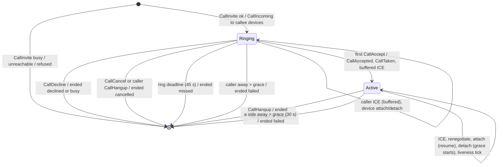

# Voice calls (1:1 audio, agent-ready) — design

Change request "voice calls" (consumer yuopolev/push-messenger, against upstream 32af9dd).
The owner is away: every open question was decided autonomously and is recorded in
[Decisions](#1-decisions). Delivered as eight independently releasable PRs
([plan](../plans/2026-11-03-voice-calls.md)); this document is the contract every PR
follows. Names and numbers below are final unless a later PR records a deviation here.

## Problem

push-messenger has text, rich cards, activity and presence, but no way to talk. Phase 1:
1:1 audio calls between accepted contacts from the web app and other clients. Phase 2: the
same calls between a person and their agent (Coda through push-agent-bridge): the agent
answers its owner, and calls its owner itself (for example for an approval). The server
carries signalling only and never sees media.

## Goals and non-goals

Goals: WebRTC peer-to-peer audio (Opus, DTLS-SRTP end to end), signalling on the existing
WebSocket, ringing on every capable device with first-accept-wins, call state shared by
every replica through Redis, call history separate from chats, short-lived TURN
credentials (internal coturn, external provider, or STUN only), SDK support, a browser
recipe, and in phase 2 a native media helper and the bridge's voice pipeline. Off by
default (`calls.enabled: false`).

Non-goals (the wire leaves room for all of them, see §4.8): video, group calls, ringing
through push notifications (APNs/FCM), recording, server-side media of any kind, calls
written into conversation history ("missed call" messages).

## 1. Decisions

| # | Topic | Decision |
|---|---|---|
| D1 | Who runs the call engine | **message-svc**. The gateway stays a relay, as for every other frame: it forwards call frames over a new `Messaging.Call` RPC and tells message-svc when a calls-capable connection attaches or detaches. message-svc owns the policy (contacts, blocks, agent ownership in PostgreSQL), the state machine, Redis call state, timers, audit and metrics. Rejected: the engine in the gateway (it would need a policy RPC anyway, and phase-1 history writes rows message-svc owns). |
| D2 | State machine | Pure Rust in `push-domain` (`push_domain::calls`): `transition(record, event, now) -> Outcome`. No I/O, table-driven tests. Redis is storage with compare-and-set; Lua does atomic CAS and the busy locks, never policy. |
| D3 | Redis layout | Every call key carries the hash tag `{calls}` so a call's record, both users' busy locks and the due set share one cluster slot (atomic scripts stay cluster-safe). Phase-1 volume (≤ thousands of live calls) fits one shard; documented as a scaling limit. |
| D4 | Clock | Redis `TIME` is the only clock for deadlines (load and claim scripts return it). Clients get relative `expires_in_ms` as well as the absolute `expires_at`, so a skewed client clock never shortens or lengthens ringing. |
| D5 | Timers | A sweeper in every message-svc replica claims due calls from the `calls:{calls}:due` sorted set every 500 ms; a claim pushes the entry 5 s ahead (a lease), so a replica that dies mid-claim is covered by another. Each live call has exactly one due entry. |
| D6 | Device reachability | A connection is *calls-active* when the gateway has calls enabled, message-svc offers calls (its `IdentifyResponse.capabilities`), and the client advertised `CAPABILITY_CALLS` in `Identify`. Only calls-active connections are attached (registry `calls:{calls}:devices:<user>`: device → connection id). Liveness of an attached device = its connection still holds a presence lease (`presence:{<user>}:conns`, maintained by the gateway already). No extra refresh traffic. |
| D7 | Resume | After `Ready`, a calls-active connection is attached and the server sends `CallSync`: the calls the user is in, as this device sees them (a ringing incoming call includes its offer). Covers reconnects within the grace, gateway restarts, lost `CallIncoming`/`CallEnded`. A client drops any local call that `CallSync` does not list. |
| D8 | Pre-answer ICE | The caller trickles ICE while ringing; message-svc buffers up to 32 such candidates in the call record and relays them to the answering device right after the accept, in order. Ringing devices never receive the caller's candidates. |
| D9 | Endings fan-out | `CallEnded` goes to every involved device: the caller's device, and the callee's ringing devices (while ringing) or answering device (once active), including the device whose frame ended the call (a confirmation). |
| D10 | Strictness | Every frame's `call_id` must belong to the sender's device in its current role, otherwise `CALL_NOT_FOUND` (same answer for unknown, ended, someone else's, wrong role: no oracle). `CallCancel` after an accept is `ALREADY_ANSWERED` (the client then hangs up). `CallHangup` while ringing is accepted: from the caller it ends the call as `cancelled`, from a ringing callee device as `declined`. |
| D11 | "NOT_A_CONTACT" | The request's `NOT_A_CONTACT` is the existing `ERROR_CODE_NOT_CONTACT` (6). Unknown callee, non-contact, pending request, a block either way, an agent rule: all `NOT_CONTACT`, indistinguishable. |
| D12 | Owner ↔ agent | The pair is callable whenever neither side blocked the other, even if a contact row was removed ("always contacts"). An agent may call only its owner; only its owner may call it. Needs `Tx::agent_owner(user)`. Phase 2 needs no further server change. |
| D13 | Attempts per hour | Counted by the gateway's existing fixed-window limiter (`Action::CallInvite`, per user, `calls.attemptsPerHour`, default 30), on every `CallInvite` before it reaches message-svc, refused or not. Fails closed (Redis down = calls down anyway). |
| D14 | SDP | Parsed only to enforce size (≤ 16 KiB), line structure and audio-only media: at least one `m=audio`, any other `m=` kind (video, application, text, message, …) is `INVALID` ("video is not available" for video). Never stored beyond the call, never logged. |
| D15 | Limits | ≤ 200 `CallIce` frames per side per call (`CALL_LIMIT` after), ≤ 32 of them buffered before the answer, ≤ 20 `CallRenegotiate` per side per call; candidate ≤ 512 bytes printable ASCII, `sdp_mid` ≤ 32 bytes, `username_fragment` ≤ 256 bytes. |
| D16 | Blocks during a call | A block does not end a call already ringing or active (either side can end it); it prevents the next one. |
| D17 | Metrics | No metrics stack exists. message-svc serves Prometheus text on its health listener `GET /metrics`, hand-rolled (atomics, no new dependency). PR 3 adds the TURN counters there; coturn exposes its own exporter. |
| D18 | Audit | `tracing` lines with `target: "security"` (the repo's audit convention): `event = "call.started"` and `event = "call.ended"`. Never SDP, candidates, IPs or device addresses. |
| D19 | Record encoding | The call record is JSON (`serde`) with `"v": 1`; unknown fields are ignored and new fields default, so mixed message-svc versions read each other's records during a rollout. |
| D20 | History & TURN APIs | HTTP on auth-svc (it serves the public `/v1/…` API and verifies access tokens), backed by a new internal `Calls` gRPC service on message-svc's directory listener (the Templates pattern). The auth Ingress gains the `/v1/calls` prefix. |
| D21 | Media helper | **str0m** (sans-IO WebRTC, MIT/Apache, small dependency tree, tokio-agnostic) over webrtc-rs (large async tree, being rewritten upstream). Opus through `audiopus` (libopus, BSD-3). Behind the `calls-media` feature of push-sdk, off by default (see §10.1). |
| D22 | Transcripts in chat | The bridge cannot send as the owner, so the owner's utterances go into the chat as a new built-in card `agent.transcript@1` (`speaker: owner`, `voice: true`, text), rendered "🎤 voice"; the agent's spoken replies stay `agent.reply@2`. |

## 2. Architecture

```
client ──CallInvite/…──▶ gateway ──Messaging.Call──▶ message-svc ──policy (PostgreSQL)
                                                        │  load/CAS (Lua) on calls:{calls}:*  ──▶ Redis
                                                        └─ PUBLISH notify:{user} Notification.call ──▶ gateways ──▶ target devices
gateway (Ready, calls-active)  ──Messaging.CallAttach──▶ message-svc ──▶ CallSync to the device
gateway (connection closed)    ──Messaging.CallDetach──▶ message-svc (grace starts)
message-svc sweeper (every 500 ms) ──claim due──▶ Redis ──▶ ring timeouts, grace ends, liveness ticks
```

- Publishing completes before `Messaging.Call` answers, so two frames of one device reach
  the peer in order (Redis keeps per-channel order; the gateway handles one client frame at
  a time).
- Call frames for a device travel on the user's `notify:{user}` channel as
  `Notification.call` (`CallSignal`) naming the target devices; the hub hands each frame
  only to its connections of those devices. Old gateways decode an unknown notification
  kind as empty and drop it.

## 3. State machine

### 3.1 Record

`CallRecord` (JSON in Redis, D19):

| Field | Meaning |
|---|---|
| `v` | 1 |
| `call_id`, `caller`, `caller_device`, `callee` | fixed at the invite |
| `media` | `["audio"]` |
| `state` | `ringing` or `active` (an ended call has no record) |
| `offer` | the offer SDP (kept while ringing for `CallSync`; dropped once active) |
| `ringing_devices` | callee devices sent `CallIncoming` (only these may accept or decline) |
| `callee_device` | the answering device, once active |
| `created_ms`, `ring_deadline_ms`, `answered_ms` | Redis-clock milliseconds |
| `caller_away_ms`, `callee_away_ms` | when the party device's connection was found gone; absent while connected |
| `ice` | per side: frames relayed so far (`caller`, `callee`) |
| `renegotiations` | per side |
| `pending_ice` | caller candidates buffered before the answer (≤ 32) |
| `version` | CAS counter, kept in the hash beside the record |

### 3.2 Events

| Event | Source |
|---|---|
| `Invite` | `CallInvite` from the caller's device |
| `Accept(device, answer)` | `CallAccept` |
| `Decline(device, reason)` | `CallDecline`, or `CallHangup` from a ringing callee device |
| `Cancel` | `CallCancel`, or `CallHangup` from the caller while ringing |
| `Hangup(device, reason)` | `CallHangup` while active |
| `Ice(device, candidate)` | `CallIce` |
| `Renegotiate(device, sdp, type)` | `CallRenegotiate` |
| `Attach(device)` | `Messaging.CallAttach` for a device of a participant |
| `Detach(device)` | `Messaging.CallDetach` with the device's registered connection |
| `Tick` | the sweeper: a due entry fired (ring deadline, grace end, or liveness check) |

### 3.3 Transitions

`now` is Redis time. `ring` = `calls.ringSeconds` (45 s), `grace` =
`calls.disconnectGraceSeconds` (30 s), `LIVENESS` = 15 s. "Gone" = the party device has no
registry entry, or its connection holds no live presence lease.

| From | Event / condition | To | Effects |
|---|---|---|---|
| — | `Invite`, caller already in a call | — | `CallError{IN_CALL}` |
| — | `Invite`, callee busy (in or ringing for a call) | — | reply `CallEnded{busy}`; audit `call.ended` busy |
| — | `Invite`, callee has no attached live device | — | reply `CallEnded{unreachable}`; audit `call.ended` unreachable |
| ringing | `Invite` again with the same `call_id` from the same caller device (a retry) | ringing | ok, no reply and no frames; another sender: `CallError{INVALID}` |
| — | `Invite`, ok | ringing | `CallIncoming` to every live attached callee device; due = `now + ring`; audit `call.started` |
| ringing | `Accept` from a ringing device, `now < ring_deadline` | active | `CallAccepted` to the caller device; `CallTaken` to the other ringing devices; buffered caller ICE to the answering device; offer dropped; due = `now + LIVENESS` |
| ringing | `Accept`, `now ≥ ring_deadline` | — | `CallEnded{missed}` to all involved (the late accepter included) |
| active | `Accept` from the answering device (a retry) | active | `CallAccepted` to the caller device again; no write |
| active | `Accept` from another callee device | active | `CallError{ALREADY_ANSWERED}` to the sender only |
| ringing | `Decline(declined)` from a ringing device | — | `CallEnded{declined}` to all involved |
| ringing | `Decline(busy)` from a ringing device | — | `CallEnded{busy}` to all involved |
| ringing | `Cancel` from the caller device | — | `CallEnded{cancelled}` to all involved |
| active | `Cancel` from the caller device | active | `CallError{ALREADY_ANSWERED}` |
| active | `Hangup(completed\|failed)` from a party device | — | `CallEnded{completed\|failed, duration_s}` to both party devices |
| ringing | `Ice` from the caller device, < 32 buffered, < 200 sent | ringing | buffered |
| ringing | `Ice` from the caller device, buffer full | ringing | `CallError{CALL_LIMIT}` |
| active | `Ice` from a party device, < 200 sent | active | `peer_call_ice` to the other party device |
| any | `Ice`, 200 reached for that side | same | `CallError{CALL_LIMIT}` |
| active | `Renegotiate` from a party device, < 20 | active | `peer_call_renegotiate` to the other party device |
| active | `Renegotiate`, 20 reached | active | `CallError{CALL_LIMIT}` |
| ringing | `Renegotiate` | ringing | `CallError{CALL_NOT_FOUND}` (not in that role yet) |
| ringing | `Attach` of a callee device not ringing | ringing | added to `ringing_devices`; it gets the call in its `CallSync` |
| ringing | `Attach` of the caller device (away) | ringing | `caller_away_ms` cleared; due = ring deadline |
| active | `Attach` of a party device (away) | active | that side's away cleared; due = `now + LIVENESS` (or the other side's grace end) |
| ringing | `Detach` of a ringing device | ringing | removed from `ringing_devices` (ringing continues until the deadline) |
| ringing | `Detach` of the caller device | ringing | `caller_away_ms = now`; due = min(ring deadline, `now + grace`) |
| active | `Detach` of a party device | active | that side's away = `now`; due = min(due, `now + grace`) |
| ringing | `Tick`, `now ≥ ring_deadline` | — | `CallEnded{missed}` to all involved |
| ringing | `Tick`, caller away and `now ≥ away + grace` | — | `CallEnded{failed}` to all involved |
| active | `Tick`, liveness: a party device found live | (checked first) | that side's away cleared, before the grace check (an away time a tick wrote while the device reattached) |
| active | `Tick`, a side away and `now ≥ away + grace` | — | `CallEnded{failed, duration_s}` to both party devices |
| active | `Tick`, liveness: a party device gone, not marked away | active | that side's away = `now`; due = `now + grace` |
| active | `Tick`, otherwise | active | due = `now + LIVENESS`; TTLs refreshed |
| any | frame naming a call the sender's device has no role in | same | `CallError{CALL_NOT_FOUND}` |

Ties: the first CAS wins. Two accepts: one becomes active, the other re-reads and gets
`ALREADY_ANSWERED`. Cancel vs accept: whichever commits first; the loser gets
`CALL_NOT_FOUND` (call gone) or `ALREADY_ANSWERED`. Hangup vs reconnect: a `Hangup` ends
the call; a later `Attach` finds no call and the device's `CallSync` is empty. Grace end
vs reconnect: the `Tick` re-reads the record; an `Attach` that committed first cleared
the away time, so the tick only reschedules. An `Attach` of a party device always writes (bumping the version) so
a tick that read the registry before it loses its CAS and reads the device again; a tick
that finds a party device live clears its away time. A write whose reply was lost (a
timeout or a dropped connection) re-reads the record: if it landed, its frames are
published; retried `Invite` and `Accept` frames are idempotent (rows above).

`duration_s` = `(end − answered_ms) / 1000`, rounded down; only for calls that were
answered.

### 3.4 Diagram



## 4. Protocol (`push.v1`, frame.proto)

Additive only: new field numbers, nothing reused or renumbered. Old clients never receive
call frames (they do not advertise the capability), and would drop them (an unknown oneof
field decodes as a frame without a body).

### 4.1 Frame numbers

| Direction | Field | Number | Message |
|---|---|---|---|
| client → server | `call_invite` | 11 | `CallInvite` |
| | `call_accept` | 12 | `CallAccept` |
| | `call_decline` | 13 | `CallDecline` |
| | `call_cancel` | 14 | `CallCancel` |
| | `call_ice` | 15 | `CallIce` |
| | `call_hangup` | 16 | `CallHangup` |
| | `call_renegotiate` | 17 | `CallRenegotiate` |
| server → client | `call_incoming` | 44 | `CallIncoming` |
| | `call_accepted` | 45 | `CallAccepted` |
| | `call_taken` | 46 | `CallTaken` |
| | `call_ended` | 47 | `CallEnded` |
| | `call_error` | 48 | `CallError` |
| | `call_sync` | 49 | `CallSync` |
| | `peer_call_ice` | 50 | `CallIce` (from the other party) |
| | `peer_call_renegotiate` | 51 | `CallRenegotiate` (from the other party) |

18–31 stay free for client frames, 52–63 for server frames (PR 2 takes 52 for
`CallHistoryChanged`).

### 4.2 Messages

```proto
enum Capability {
  CAPABILITY_UNSPECIFIED = 0;
  CAPABILITY_CALLS = 1;          // 1:1 audio calls (this document)
}
// Identify: repeated Capability capabilities = 2;   what the client can do
// Ready:    repeated Capability capabilities = 4;   what this server offers

enum CallMedia { CALL_MEDIA_UNSPECIFIED = 0; CALL_MEDIA_AUDIO = 1; CALL_MEDIA_VIDEO = 2; }
enum CallEndReason {
  CALL_END_REASON_UNSPECIFIED = 0; COMPLETED = 1; MISSED = 2; DECLINED = 3; CANCELLED = 4;
  BUSY = 5; FAILED = 6; UNREACHABLE = 7;               // prefixed CALL_END_REASON_ in proto
}
enum CallSdpType { CALL_SDP_TYPE_UNSPECIFIED = 0; OFFER = 1; ANSWER = 2; }
enum CallDirection { CALL_DIRECTION_UNSPECIFIED = 0; IN = 1; OUT = 2; }
enum CallStatus { CALL_STATUS_UNSPECIFIED = 0; RINGING = 1; ACTIVE = 2; }

message CallInvite { bytes call_id = 1; bytes callee_user_id = 2; string offer_sdp = 3;
                     repeated CallMedia media = 4; }
message CallAccept { bytes call_id = 1; string answer_sdp = 2; }
message CallDecline { bytes call_id = 1; optional CallEndReason reason = 2; } // DECLINED|BUSY
message CallCancel { bytes call_id = 1; }
message CallIce { bytes call_id = 1; string candidate = 2; optional string sdp_mid = 3;
                  optional uint32 sdp_mline_index = 4; bool end_of_candidates = 5;
                  optional string username_fragment = 6; }
message CallHangup { bytes call_id = 1; optional CallEndReason reason = 2; } // COMPLETED|FAILED
message CallRenegotiate { bytes call_id = 1; string sdp = 2; CallSdpType type = 3; }

message CallIncoming { bytes call_id = 1; bytes caller_user_id = 2; string offer_sdp = 3;
                       repeated CallMedia media = 4; int64 expires_at = 5;
                       uint32 expires_in_ms = 6; }
message CallAccepted { bytes call_id = 1; string answer_sdp = 2; bytes answered_device_id = 3; }
message CallTaken { bytes call_id = 1; }
message CallEnded { bytes call_id = 1; CallEndReason reason = 2; optional uint32 duration_s = 3; }
message CallError { bytes call_id = 1; ErrorCode code = 2; string message = 3;
                    bool retryable = 4; optional uint32 retry_after_s = 5; }
message CallSync { repeated CallState calls = 1; }
message CallState { bytes call_id = 1; bytes peer_user_id = 2; CallDirection direction = 3;
                    CallStatus status = 4; repeated CallMedia media = 5;
                    optional string offer_sdp = 6;      // incoming ringing only
                    optional int64 expires_at = 7; optional uint32 expires_in_ms = 8;
                    optional int64 answered_at = 9;
                    bool this_device = 10; }            // the call's device on this side
```

Times are microseconds since the Unix epoch (Redis clock); identifiers 16-byte UUIDs as
everywhere. `call_id` is a UUIDv7 chosen by the caller (version 7 enforced).

### 4.3 Error codes (added to `ErrorCode`)

| Code | Number | When |
|---|---|---|
| `ERROR_CODE_ALREADY_ANSWERED` | 27 | Accept or Cancel after another device answered |
| `ERROR_CODE_CALL_NOT_FOUND` | 28 | No such call for this device in this role (unknown, ended, another user's, wrong role) |
| `ERROR_CODE_IN_CALL` | 29 | The caller already has a call (ringing or active) |
| `ERROR_CODE_CALL_LIMIT` | 30 | ICE or renegotiation cap for the call reached |

Existing codes used: `NOT_CONTACT` (6, the request's NOT_A_CONTACT), `INVALID` (2:
malformed ids, not a UUIDv7, self-call, bad SDP, video, bad candidate), `RATE_LIMITED`
(23, attempts per hour, with `retry_after_s`), `NOT_AVAILABLE` (24, calls not offered on
this connection), `UNAVAILABLE` (9, retryable: Redis or message-svc unavailable, CAS
retries exhausted). Call errors always come as `CallError` (never `Error`); only
`UNAVAILABLE` and `RATE_LIMITED` are retryable.

### 4.4 Capability advertisement

- The client lists `CAPABILITY_CALLS` in `Identify.capabilities` only if it can take
  calls (has call UI, or the media helper). The SDK advertises it only when the app opts in.
- `Ready.capabilities` lists what the server offers on this connection: `CAPABILITY_CALLS`
  iff the gateway has `PUSH_CALLS_ENABLED=1` and message-svc answered `Identify` with
  `CAPABILITY_CALLS` (message-svc has calls enabled). A client hides call UI otherwise.
- A connection is calls-active only with both. Only calls-active devices are attached, so
  a callee with no capable online device yields `CallEnded{unreachable}` at once.
- A non-calls-active connection that sends a call frame gets `CallError{NOT_AVAILABLE}`.

### 4.5 Client rules (summary; full recipe in docs/calls.md, PR 5)

- Only the caller makes the initial offer. Renegotiation (ICE restart, later media
  changes) may come from either side; resolve glare with "perfect negotiation", the
  **callee is polite**.
- Trickle ICE: send each local candidate as `CallIce`, then `end_of_candidates: true`.
  Candidates from the peer may arrive before `CallAccepted` is processed; buffer them.
- Ring locally for `expires_in_ms` from receipt; stop on `CallTaken` or `CallEnded`.
- After a reconnect, read `CallSync`: drop calls not listed; for a listed active call with
  `this_device`, do an ICE restart through `CallRenegotiate` (offer with `iceRestart`).
- `CallCancel` answered `ALREADY_ANSWERED`: the call connected; send `CallHangup`.

### 4.6 Rolling upgrades and compatibility

| Combination | Result |
|---|---|
| old client, any server | never advertises; never attached; callers see `unreachable`; messaging unchanged |
| new client, old gateway | `Ready` without capabilities: call UI hidden; a call frame would be `BAD_FRAME` |
| new gateway, old message-svc | `IdentifyResponse` without capabilities: calls not offered; frames `NOT_AVAILABLE` |
| new gateway and message-svc, `calls.enabled: false` | not offered |
| mixed message-svc replicas | a `Call` RPC landing on an old replica is `UNIMPLEMENTED` → `CallError{UNAVAILABLE}` (retryable); only new replicas sweep |
| mixed gateway replicas | devices on old gateways are not attached (unreachable on them); `Notification.call` is ignored by old gateways |
| downgrade | records expire by TTL; nothing persistent in phase 1 PR 1 |

Operators enable `calls.enabled` after every gateway and message-svc replica runs a
version with calls; the chart sets both services from the one value.

### 4.7 Internal API (`push.internal.v1`)

```proto
// Messaging service, added:
rpc Call(CallRequest) returns (CallReply);
rpc CallAttach(CallDeviceRequest) returns (push.v1.CallSync);
rpc CallDetach(CallDeviceRequest) returns (CallDetachResponse);

message IdentifyResponse { repeated push.v1.Capability capabilities = 1; }
message CallRequest { bytes user_id = 1; bytes device_id = 2;
  oneof frame { push.v1.CallInvite invite = 3; push.v1.CallAccept accept = 4;
    push.v1.CallDecline decline = 5; push.v1.CallCancel cancel = 6; push.v1.CallIce ice = 7;
    push.v1.CallHangup hangup = 8; push.v1.CallRenegotiate renegotiate = 9; } }
message CallReply { optional push.v1.CallEnded ended = 1; }   // immediate busy/unreachable
message CallDeviceRequest { bytes user_id = 1; bytes device_id = 2; bytes connection_id = 3; }
message CallDetachResponse {}
// Notification: CallSignal call = 7;
message CallSignal { repeated bytes device_ids = 1;
  oneof frame { push.v1.CallIncoming incoming = 2; push.v1.CallAccepted accepted = 3;
    push.v1.CallTaken taken = 4; push.v1.CallEnded ended = 5; push.v1.CallIce ice = 6;
    push.v1.CallRenegotiate renegotiate = 7; } }
```

`Call` errors are statuses carrying a `push.v1.Error` (as every Messaging RPC); the
gateway turns them into `CallError` with the frame's `call_id`. message-svc with calls
disabled answers `Call`/`CallAttach` with `FAILED_PRECONDITION` (`NOT_AVAILABLE`).

### 4.8 Extensibility (no breaking change needed)

- **Video**: `CALL_MEDIA_VIDEO` exists; a later release accepts it when both sides
  advertise a new `CAPABILITY_CALLS_VIDEO`, and the SDP check allows `m=video`.
- **Group calls**: a new `repeated bytes callee_user_ids` on `CallInvite`, a
  `participants` list on `CallState`, `CAPABILITY_CALLS_GROUP`; the record grows a
  participant map (D19 allows it). 1:1 frames keep their meaning.
- **Push ringing**: `CAPABILITY_CALLS_PUSH` devices registered for push are counted as
  reachable; `CallIncoming` stays the same frame, delivered after the push wakes the app
  (offer fetched through `CallSync`).
- **Recording**: a `recording` flag on `CallState`/`CallAccepted` and a consent frame;
  media stays peer to peer (a recorder is a third participant, i.e. after group calls).

## 5. Redis data model and expiry

All keys tagged `{calls}` (D3). Times are Redis-clock milliseconds.

| Key | Type | Content | Expiry |
|---|---|---|---|
| `calls:{calls}:call:<call_id>` | hash | `ver` (integer), `rec` (JSON record) | ringing: `ring_deadline + 60 s`; active: `now + 120 s`, refreshed by every write and liveness tick (≤ 15 s apart); deleted at the end |
| `calls:{calls}:user:<user_id>` | string | the user's call id (busy lock; one call per user, all devices) | same as the record; deleted at the end if it still names the call |
| `calls:{calls}:devices:<user_id>` | hash | device id → connection id of each attached (calls-active) connection | 24 h, refreshed on attach; field removed on detach of that connection |
| `calls:{calls}:due` | sorted set | call id → next deadline | member removed at the end; a claim pushes it 5 s ahead |
| gateway limiter `rl:…` | string | fixed window counter for `CallInvite` (existing limiter, hashed subject) | the window |

Scripts (EVALSHA, reloaded on NOSCRIPT, as presence):

- **load**(`call`): `{ver, rec, TIME}`.
- **apply**(`call`, `due`, user keys…; expected `ver`, new `rec` or delete, ttl, due score,
  users to lock, users to release): checks `ver` (or absence for a create), for a create
  checks the caller's then the callee's lock (`IN_CALL` / `BUSY` / `CALL_EXISTS`), writes
  everything or nothing. Returns `OK`, `CONFLICT`, `IN_CALL`, `BUSY` or `EXISTS`.
- **claim**(`due`; max 32, lease 5000): due members ≤ `TIME`, each pushed to now + lease;
  returns them with `TIME`.
- **attach**/**detach**(`devices:<user>`; device, connection): set / remove-if-equal.

Liveness of an attached device: `ZSCORE presence:{<user>}:conns <connection>` > now
(another slot: read outside the scripts, tolerant of races). If Redis loses everything,
calls in progress lose their state: the next frame of either side gets `CALL_NOT_FOUND`,
media continues peer to peer until a side hangs up locally.

The record is bounded: offer ≤ 16 KiB (dropped when answered), ≤ 32 buffered candidates
(≤ 1 KiB each with metadata) — under 50 KiB per call, one call per user.

## 6. Failure matrix

| Failure | Effect | Recovery |
|---|---|---|
| Gateway graceful restart (rollout, 4005) | connections detach → grace starts | clients reconnect elsewhere within seconds → attach → `CallSync` → ICE restart; media is peer to peer and usually never stops |
| Gateway crash (no close) | no detach | the presence lease of its connections ends ≤ 90 s later; the next liveness tick (≤ 15 s) marks the side away, grace applies: the call ends `failed` ≤ ~135 s later unless the client reconnected (it normally does within seconds, which resumes) |
| message-svc replica crash | in-flight `Call` RPC fails → `CallError{UNAVAILABLE}`; a claimed due entry re-fires after its 5 s lease on another replica | automatic |
| All message-svc down | call frames `UNAVAILABLE`; no timers run | keys expire 120 s after the last write (ringing: 60 s after the deadline), releasing the busy locks |
| Redis failover without data | records, locks and registry lost | frames get `CALL_NOT_FOUND`; clients end locally; devices re-attach on reconnect; `CallSync` empty |
| Redis failover, pub/sub messages lost | a `CallIncoming`/`CallEnded`/relay may be lost | ringing ends by deadline on both sides (clients time out locally with `expires_in_ms`); the hub rings all connections after resubscribing and clients reconnecting get `CallSync`; ICE has redundancy (restart via renegotiate) |
| Redis unavailable | invite `UNAVAILABLE` (limiter fails closed too) | retry |
| Half-open client socket | detected by the gateway's heartbeat rule (2.5 heartbeats, 75 s by default) → detach → grace | the grace starts at detection, so a half-open socket ends a call ≤ 75 s + 30 s after it died; documented |
| Half-open message-svc channel | HTTP/2 keepalive (existing) fails calls fast | retry |
| Clock skew between replicas | none: Redis `TIME` only | — |
| Client clock skew | ringing uses `expires_in_ms` from receipt | — |
| CAS contention (races) | retried up to 5 times, then `UNAVAILABLE` (retryable) | client retries |
| Takeover (same device, new connection) | attach replaces the registry entry; the old connection's detach no longer matches and changes nothing | — |
| Device revoked / password reset mid-call | the kick closes the connection → detach → grace → `failed` | — |

## 7. Threat model

| # | Threat | Mitigation | Test (file) | PR |
|---|---|---|---|---|
| T1 | Calls from non-contacts or blocked users | policy in message-svc: both directions `ACCEPTED`, no block either way; unknown ids look the same (`NOT_CONTACT`) | `calls_policy_*` in `push-domain/src/calls/tests.rs`; `a_stranger_or_blocked_user_cannot_call` in `push-gateway/tests/calls.rs` | 1 |
| T2 | Ringing used to spam a user | one ringing call per caller (`IN_CALL`), busy lock per callee, `calls.attemptsPerHour` per user (also counts refused invites), frame budget, decline/block | `attempts_per_hour_are_limited`, `a_caller_has_one_call_at_a_time` (gateway calls tests); limiter unit test | 1 |
| T3 | Call-state spoofing (accept/end another's call by `call_id`) | every frame checked against the record: sender user and device in their role; identical `CALL_NOT_FOUND`; call ids are unguessable UUIDv7 but never trusted | table tests `wrong_role_*`; `another_users_device_cannot_touch_the_call` (gateway) | 1 |
| T4 | SDP / ICE injection, oversize or malformed | size caps (16 KiB SDP, 512 B candidate), line grammar, printable ASCII candidates, audio only, protobuf decode limits; never interpreted beyond that, relayed as opaque strings | proptest `sdp_*`, `ice_*` in `push-domain/src/calls/sdp.rs`; frame-decode proptest in push-proto; `oversize_and_video_offers_are_refused` (gateway) | 1 |
| T5 | TURN used to reach internal addresses (SSRF, lateral movement) | coturn `denied-peer-ip` for RFC 1918, 100.64/10, link-local (incl. 169.254.169.254 metadata), loopback, the cluster pod and service CIDRs, IPv6 ULA/link-local/loopback, `no-multicast-peers`, `no-loopback-peers`; NetworkPolicy egress | chart tests render every range; integration test: a relay allocation to 10.x/127.x/169.254.169.254 is refused by the real coturn container | 3 |
| T6 | TURN credential theft or replay | credentials expire (`ttlSeconds`, 600 s), scoped to the user (`<expiry>:<user_id>`), minted only for an access token, never logged, HTTPS only; `user-quota` limits damage | `credentials_expire_and_name_the_user`, `credentials_are_never_logged`, coturn refuses an expired credential | 3 |
| T7 | Leaking IP addresses to non-contacts | SDP/ICE only after the contact policy; callee's IPs only after the callee accepts; pre-answer caller ICE only to the answering device; docs recommend trickle (offer without candidates) and `iceTransportPolicy: relay` for privacy; no IPs in logs/metrics/audit | `ringing_devices_never_get_caller_candidates`, `answer_and_ice_only_reach_the_party_device` (gateway); log-capture test | 1 (+ docs 5) |
| T8 | DoS by exhausting call state | one call per user; bounded record (< 50 KiB); TTLs on every key; attempts/hour; ICE and renegotiation caps; due set bounded by live calls | `records_are_bounded` (domain), `keys_expire_without_message_svc` (message-svc redis test), limits tests | 1 |
| T9 | Agents calling anyone but their owner | policy: an agent may only call its owner, only its owner may call it (`NOT_CONTACT` otherwise), checked for both directions | `agent_calls_only_its_owner`, `only_the_owner_calls_the_agent` (domain + gateway) | 1 (bridge use: 7, 8) |
| T10 | Media or signalling content in logs, metrics, audit | no `Debug` of call frames in logs; audit fields fixed (ids, reason, duration); metrics labels are reasons/codes only | `no_sdp_or_candidate_in_logs_or_audit` (gateway calls test with a capturing subscriber) | 1 |
| T11 | Call history seen by others | rows per participant, read only by `user_id = caller`; delete hides only one's own row | `history_is_private_and_hides_per_side` | 2 |
| T12 | Provider API secrets (cloudflare/twilio) leak | secrets only from the Secret (file), never values; never logged; cached credentials in memory | chart refuses inline secrets; `provider_secrets_never_logged` | 3 |

## 8. TURN (PR 3)

`GET /v1/calls/ice-servers` on auth-svc (access token): `{"ice_servers":[{"urls":[…],
"username":"…","credential":"…"}],"expires_at":"<RFC 3339>","relay":true|false}`.
Unavailable configuration or provider failure → `503 {"error":"turn_unavailable"}`,
never unusable servers. Rate limit: 60 per user per hour. Metric
`push_turn_credentials_issued_total{mode}` / `…_failures_total{mode}`.

| Mode | Servers | Credential |
|---|---|---|
| `internal` | chart-deployed coturn: `stun:<publicHost>:3478`, `turn:<publicHost>:3478?transport=udp`, `turn:…?transport=tcp`, `turns:<publicHost>:5349?transport=tcp` (only with `tlsSecret`) + `stunUrls` | TURN REST: `username = "<expiry unix s>:<user_id>"`, `credential = base64(HMAC-SHA1(turn-shared-secret, username))`, expiry = now + `ttlSeconds` |
| `external` / `generic` | `external.urls` + `stunUrls` | same TURN REST scheme with the provider's shared secret (Secret key `turn-shared-secret`) |
| `external` / `cloudflare` | from the provider | `POST https://rtc.live.cloudflare.com/v1/turn/keys/<keyId>/credentials/generate-ice-servers` (Bearer token from Secret key `turn-cloudflare-token`), `ttl` = `ttlSeconds`; cached per user until 60 s before expiry |
| `external` / `twilio` | from the provider | `POST https://api.twilio.com/2010-04-01/Accounts/<sid>/Tokens.json` (Basic auth, token from Secret key `turn-twilio-token`), `Ttl` = `ttlSeconds`; cached (shared, not per user) until 60 s before expiry |
| `stun-only` | `stunUrls` (must not be empty in this mode: a validation error names `calls.turn.stunUrls`) | none; `relay: false`. Development only |

coturn (internal): image pinned by digest (`coturn/coturn:4.6.3@sha256:…`, CI scans it with
Trivy), `use-auth-secret`, `static-auth-secret` from the app Secret key
`turn-shared-secret` (consumer-managed supported), `realm`, `listening-port 3478`,
`tls-listening-port 5349` (with `tlsSecret`), `min-port`/`max-port` from
`relayPortRange`, `no-tcp-relay` **off** (TCP relay allowed), `denied-peer-ip` for every
range in T5 plus `calls.turn.internal.deniedPeerCidrs` (cluster pod/service CIDRs,
required), `user-quota 12`, `total-quota 1200`, `max-bps 512000` (values configurable),
`no-cli`, `no-multicast-peers`, `no-loopback-peers`, `prometheus` on 9641, `fingerprint`,
`stale-nonce 600`. Its own Service (`type: LoadBalancer` by default, UDP+TCP ports and the
relay range), readiness/liveness TCP probes on 3478. NetworkPolicy: ingress on its ports
from anywhere; egress to anywhere except the denied ranges. Security trade-offs documented
in docs/calls.md: a public relay is an open UDP port range; the denied ranges and quotas
are what keep it from being an SSRF or bandwidth amplifier.

## 9. Call history (PR 2)

- Table `messaging.call_history` (migration `0008_call_history.sql`): `call_id uuid`,
  `user_id uuid`, `peer_user_id uuid`, `direction text ('in'|'out')`, `started_at`,
  `answered_at null`, `ended_at`, `duration_s int`, `outcome text`, `hidden_at null`;
  primary key `(user_id, call_id)`; index `(user_id, ended_at desc, call_id)`. Two rows per
  call, written when the call ends (also immediate busy/unreachable outcomes: the caller's
  row always; the callee's row for every outcome except `unreachable`, which the callee
  never saw), `ON CONFLICT DO NOTHING` (a re-run end is idempotent).
- Nothing about calls in conversation history.
- `GET /v1/calls?before=<cursor>&limit=50` (auth-svc → `Calls.History` gRPC): own rows not
  hidden, newest first, `limit` 1–100 (default 50), `cursor` = opaque base64url of
  `(ended_at, call_id)`; answer `{"calls":[{call_id, peer_user_id, direction, started_at,
  answered_at?, ended_at, duration_s, outcome}], "next": "<cursor>"?}`. `?since=<cursor>`
  returns rows newer than the cursor (for badges).
- `DELETE /v1/calls/{call_id}` sets `hidden_at` on the caller's own row: 204 (also when
  absent: no oracle).
- Retention `calls.historyDays` (default 90, 1–3650): message-svc deletes rows with
  `ended_at` older than that, hourly, in batches of 1000.
- Server frame `CallHistoryChanged { optional int64 latest_ended_at = 1; }` = 52, sent to
  the user's calls-active devices after their row is written (badge refresh).
- Metrics: `push_call_history_rows_deleted_total`.

## 10. SDK (PR 4), docs (PR 5) and phase 2 (PRs 6–8)

### 10.1 push-sdk Calls API

```rust
// ClientConfig::calls(true) makes the client advertise CAPABILITY_CALLS.
impl Client {
    pub fn calls(&self) -> Calls;                         // handle
}
impl Calls {
    pub fn available(&self) -> bool;                      // Ready offered CAPABILITY_CALLS
    pub async fn ice_servers(&self) -> Result<IceServers>;        // GET /v1/calls/ice-servers
    pub async fn invite(&self, peer: UserId, offer_sdp: &str) -> Result<CallId>;
    pub async fn accept(&self, call: CallId, answer_sdp: &str) -> Result<()>;
    pub async fn decline(&self, call: CallId, busy: bool) -> Result<()>;
    pub async fn cancel(&self, call: CallId) -> Result<()>;
    pub async fn hangup(&self, call: CallId, failed: bool) -> Result<()>;
    pub async fn send_ice(&self, call: CallId, candidate: IceCandidate) -> Result<()>;
    pub async fn renegotiate(&self, call: CallId, sdp: &str, kind: SdpKind) -> Result<()>;
    pub async fn history(&self, before: Option<&str>, limit: u32) -> Result<CallPage>;
    pub async fn hide(&self, call: CallId) -> Result<()>;
}
// Event::Call(CallEvent): Incoming, Accepted, Taken, Ended, PeerIce, PeerRenegotiate,
// Error, Synced(Vec<CallState>), HistoryChanged.
```

Calls are fire-and-forget frames (like activity): `Offline` while disconnected, local
validation (SDP size, candidate) mirrors the server's. C and Node bindings follow with the
events in their JSON form (`docs/sdk-bindings.md`).

The media helper (PR 6, feature `calls-media`): `MediaCall::start(calls, ice_servers,
role) -> MediaCall` with `incoming() -> impl Stream<Item = PcmFrame>` (16 kHz mono, 20 ms,
`i16`), `outgoing() -> PcmSink`, `on_ended()`. str0m drives ICE/DTLS/SRTP; Opus 48 kHz via
audiopus; resampling 48 k ↔ 16 k in-house (polyphase FIR). It may exceed the workspace
MSRV only behind the feature (the `msrv` job builds default features).

### 10.2 Docs (PR 5)

`docs/calls.md`: protocol with sequence diagrams (normal flow, every ending, reconnect,
renegotiation), glare rules, trickle and restart, TURN modes and security, configuration
reference (every `calls.*` value with its validation error), AKS deployment (public UDP
LoadBalancer, NSG ports 3478/udp+tcp, 5349/tcp, relay range/udp, DNS), local cluster,
troubleshooting (no audio, one-way audio, symmetric NAT, corporate firewalls and `turns:`
on 443), retention, upgrade guide, interop checklist (Chromium, Edge, Firefox, Safari).
`docs/examples/calls/index.html`: a minimal browser client; Playwright smoke test with
Chromium fake media devices between two contexts (stun-only and internal TURN).

### 10.3 Bridge voice pipeline (PR 7)

`push-agent-bridge` config `calls` block:
`{ "answer": "auto"|"ask", "stt": {"provider": "azure-speech"|"local"|"none", …},
"tts": {…}, "vad": {"silence_ms": 700, "min_speech_ms": 300}, "language": "en-US" }`.
Pipeline: media helper PCM → VAD (energy + zero-crossing, in-house) → utterances → STT →
prompt (idle) or steer (turn running) to Coda; replies → markdown stripped (code blocks →
"I've put the code in the chat", tables → "I've put a table in the chat") → sentences →
TTS → PCM sink; owner speech during TTS = barge-in (TTS stops, utterance steered).
Transcripts in chat: `agent.transcript@1` for the owner (D22), `agent.reply@2` for the
agent. Activity labels "on a call", "listening", "thinking", "speaking". Voice answers to
an open card: transcript matched against its options (exact / ordinal "option two" /
approve/reject synonyms); ambiguous → asks again; the card answer carries `via: "voice"`.
Providers: `azure-speech` (key or Entra; audio leaves the machine to Azure), `local`
(whisper.cpp-compatible STT binary, a local TTS command; audio stays local), `none`.
Fakes for CI with recorded fixtures.

### 10.4 Answering and calling policies (PR 8)

`calls.answer: "ask"` posts `agent.approval`-style card "Owner is calling — answer?" on the
owner's other devices, answers on approve, declines after the ring. On answer the bridge
says "Connected to Coda in <folder name>". `calls.notify_by_call`: `{ "after_minutes": 0
(off), "urgent": false, "min_interval_minutes": 10, "do_not_disturb": "22:00-07:00" }`:
calls the owner when a permission request or question is unanswered for `after_minutes`,
or when `notify_user` marks something urgent (if `urgent`); opens with a spoken summary
and the question; missed or declined → the card stays as the fallback. Tray: per-agent
call state (ringing, in call, speaking) and Mute agent / Hang up in the window.

## 11. Metrics (message-svc `/metrics`, PR 1)

| Metric | Type | Labels |
|---|---|---|
| `push_calls_started_total` | counter | — |
| `push_calls_answered_total` | counter | — |
| `push_calls_ended_total` | counter | `reason` (completed, missed, declined, cancelled, busy, failed, unreachable) |
| `push_call_frames_refused_total` | counter | `code` |
| `push_call_setup_seconds` | histogram | — (accept received → `CallAccepted` published) |
| `push_call_signal_seconds` | histogram | `frame` (time to handle and publish a call frame) |
| `push_calls_live` | gauge | — (`ZCARD calls:{calls}:due` at scrape) |

Missed, failed and busy are `push_calls_ended_total{reason=…}`. Load targets (PR 4 extends
push-load): invite → `CallAccepted` relayed < 300 ms p95 within a region; 1,000 concurrent
ringing or active calls per gateway replica without errors.

## 12. Configuration

Chart values (PR 1 adds the first four; PR 2 `historyDays`; PR 3 `turn`):

| Value | Default | Validation (chart `fail`, and the service at start) | Env |
|---|---|---|---|
| `calls.enabled` | `false` | boolean | `PUSH_CALLS_ENABLED` (`1`/`0`) on gateway and message-svc |
| `calls.ringSeconds` | 45 | integer 10–120: "calls.ringSeconds must be an integer from 10 to 120" | `PUSH_CALLS_RING_SECONDS` (message-svc) |
| `calls.disconnectGraceSeconds` | 30 | integer 5–120 | `PUSH_CALLS_DISCONNECT_GRACE_SECONDS` (message-svc) |
| `calls.attemptsPerHour` | 30 | integer 1–1000 | `PUSH_CALLS_ATTEMPTS_PER_HOUR` (gateway) |
| `calls.historyDays` | 90 | integer 1–3650 | `PUSH_CALLS_HISTORY_DAYS` (message-svc) |
| `calls.turn.*` | see the request | mode enum; `internal.publicHost` required when internal and calls enabled; `stunUrls`/`external.urls` must start with `stun:`/`turn:`/`turns:`; provider secrets only by Secret key | auth-svc `PUSH_TURN_*` (PR 3) |

Services refuse invalid values at start with the variable name (existing `ConfigError`
style).

## 13. Testing (PR 1)

- Domain: table-driven transition tests (every row of §3.3, every timeout, the races:
  two accepts, cancel vs accept, hangup vs reconnect, tick vs attach), policy tests
  (contacts, pending, blocks both ways, unknown, agent rules), proptest for the SDP and
  ICE validators (never panic, size limits exact, any non-audio `m=` refused).
- push-proto: proptest that arbitrary bytes never panic `decode_frame` and call frames
  round-trip.
- Store contract: `agent_owner` on memory and PostgreSQL.
- message-svc: Redis scripts against real Redis (CAS conflict, busy/in-call/exists, claim
  lease, TTLs, attach/detach-if-equal), config validation.
- Gateway integration (`tests/calls.rs`): two gateway replicas, two message-svc instances,
  one Redis: every acceptance case in the request's phase-1 list except history (PR 2),
  with short ring (2 s) and grace (1 s).
- Chart: values render to env, validation messages.

## 14. Open items for later PRs

- PR 3 must confirm Cloudflare/Twilio endpoints against current provider docs and pick
  the coturn digest at implementation time.
- PR 6 must confirm str0m's crypto backend passes cargo-deny (no OpenSSL licence issue;
  prefer a pure-Rust/ring backend) and record the MSRV of the feature.
- Presence-lease-based liveness ties calls to the presence key layout
  (`push_proto::presence_conns_key`); a change there must update `calls::liveness`.
